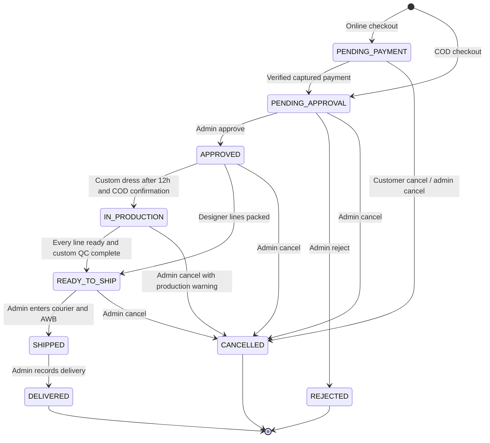

# Florangi

Florangi is a mobile-first storefront and owner-operated admin application for designer and made-to-measure dresses. The current implementation and [project context](PROJECT_CONTEXT.md) supersede the archived original requirements and build prompt below.

## Local setup

Prerequisites: Node.js 20.9 or newer, npm, and Docker with Compose.

1. Copy `.env.example` to `.env`; set a unique `SESSION_SECRET` of at least 32 characters and an admin email/password.
2. Start the development database with `docker compose up -d`. Florangi uses host port `5433` to avoid colliding with an existing local database.
3. Install packages with `npm ci`.
4. Generate the client and apply migrations with `npm run db:generate` and `npm run db:migrate`.
5. Create the initial admin and development settings with `npm run db:seed`.
6. Start the app with `npm run dev` and open `http://localhost:3000`.
7. For local email processing, open `/dev` and use **Run jobs now**. Vercel Cron runs only on the production deployment.

Customers shop and check out as guests; no customer account or login is available. Checkout saves first name, last name, phone number, email and delivery address directly on the order. Anyone can open `/track-order` and enter the displayed order number (for example, `FLR-2026-000001`) to view limited order status, items, totals and shipping progress. Private order details and payment/replacement actions at `/orders/[id]` require the order-specific secure link delivered by email; activating it grants access in that browser without creating a customer session. Public tracking never reveals buyer contact details, addresses, measurements, private notes or carrier tracking URLs.

Open `/admin` to sign in with the predefined `ADMIN_EMAIL` and `ADMIN_PASSWORD` configured before seeding. Only admin identities can use this login. Change development credentials before deployment.

Development transactional emails are encrypted in the database outbox and can be opened at `/dev/emails`. The default payment driver is `mock`; successful test capture is available from the order confirmation/details page.

### Provider setup

Keep credentials in `.env`, never in `.env.example` or source control. Rotate credentials if they have been exposed. Set `SESSION_SECRET` to the existing secret used for this database: changing it invalidates sessions and makes existing encrypted email jobs unreadable.

- **Razorpay:** Set `PAYMENT_DRIVER=razorpay`, `RAZORPAY_KEY_ID`, `RAZORPAY_KEY_SECRET`, and `RAZORPAY_WEBHOOK_SECRET`. Start with matching test-mode keys. Configure a Razorpay webhook at the publicly accessible `APP_URL/api/razorpay/webhook` using the same webhook secret, and subscribe to `payment.captured`, `order.paid`, `payment.failed`, and `refund.processed`. The key ID is returned to checkout by the server; no separate public-key variable is required. Verify payment capture, webhooks and refunds in a test environment before using live keys.
- **Cloudinary:** Set `STORAGE_DRIVER=cloudinary` and the three `CLOUDINARY_CLOUD_NAME`, `CLOUDINARY_API_KEY`, and `CLOUDINARY_API_SECRET` values. New catalog images use public delivery; replacement photos use authenticated storage and are served through application-authorized expiring links. Existing local files remain local until explicitly migrated; see [storage migration](#storage-migration). Validate authenticated delivery and access controls on a staging account before production.
- **Resend:** Set `EMAIL_DRIVER=resend`, `RESEND_API_KEY`, and `EMAIL_FROM` to a sender on a domain verified with Resend. Set `EMAIL_REPLY_TO` to a suitable reply address. A Gmail sender is not a substitute for domain verification. Queued order emails are sent by the scheduled cron, not by the web process alone.

Restart the app after configuration changes. Do not switch a database with pending mock payments to Razorpay without reconciling those orders first. Provider configuration alone does not establish production readiness.

### Deploying on Vercel

In the Vercel project, open **Settings > Environment Variables** and configure the Production environment. Do not import the development defaults from `.env.example` unchanged.

- Set `PAYMENT_DRIVER=razorpay` and provide `RAZORPAY_KEY_ID`, `RAZORPAY_KEY_SECRET`, and `RAZORPAY_WEBHOOK_SECRET` as described above. An unset `PAYMENT_DRIVER` defaults to `mock`, which is deliberately forbidden in production. Do not change `NODE_ENV` to bypass this safeguard.
- Set `EMAIL_DRIVER=resend`, `RESEND_API_KEY`, `EMAIL_FROM`, and `EMAIL_REPLY_TO` for a verified sender. The default `dev` email driver is also forbidden in production.
- Set `DATABASE_URL` to a Vercel-accessible PostgreSQL database, `SESSION_SECRET` to a secure secret of at least 32 characters, `CRON_SECRET` to a separate secure secret, and `APP_URL` to the public HTTPS address. Do not use the example's localhost database or URL.
- Configure Cloudinary as described above for persistent uploads; local filesystem storage is not suitable for Vercel functions. Treat credentials and `SESSION_SECRET` as secrets and never commit or share them.

Select Preview separately if it needs its own configuration and isolated test providers/database. Save the variables and redeploy: changes do not affect existing deployments. Apply the committed database migrations to the intended database with `npm run db:deploy` from a properly configured environment; do not reset an existing database. Check runtime logs after opening the new deployment. A successful build alone does not verify runtime configuration.

For pre-launch testing, Razorpay test-mode keys can be used without enabling mock payments. Use an isolated test database and test provider accounts, and make it clear that orders are not real. The current Production-branch deployment uses Production-scoped Vercel variables even when it is only being used for testing. A Preview deployment uses Preview-scoped variables; check Deployment Protection if testers or Razorpay webhooks cannot access its URL. Treat an unprotected URL as public, not private.

Vercel Cron calls `GET /api/cron/tick` daily at 01:00 UTC (06:30 IST), using `Authorization: Bearer <CRON_SECRET>`. On Hobby, the call can occur at any time during that hour. Cron runs only on the production deployment, is best-effort, and is not automatically retried on failure; monitor Vercel logs and the admin email queue. Email delivery and retries may be delayed by a day or longer, and COD reminders are queued at least 24 hours after the initial confirmation email is processed. Each run processes at most 100 jobs. To run it manually, send an authenticated GET request to the production endpoint. Never expose the secret in client code or logs. Stop any previously deployed standalone worker or old scheduler when switching; old processes can still expire orders.

Resend's free plan currently allows 100 emails per UTC day and 3,000 per month. Set `EMAIL_DAILY_QUOTA` to 100 or lower; use a lower value if the Resend account also sends email outside this database. The application does not track Resend's monthly quota or external sends. Review provider usage and failed jobs; quota exhaustion or a missed cron can delay emails and confirmation links.

Unpaid orders are not automatically expired. Review pending payments and cancel unwanted orders using the admin **Cancel and release stock** action; do not edit inventory or statuses directly. Test providers, scheduled processing and cancellation before accepting real orders; review [open decisions](#owner-decisions) before launch.

## Checks

- `npm run typecheck`
- `npm run lint`
- `npm run db:validate`
- Use `/dev` to run email jobs locally; check Vercel Cron logs after deployment.

## Migration history

The pre-production dry-run migrations are consolidated into `prisma/migrations/20261103010000_init/migration.sql`, including all 25 custom integrity checks and the optional category-image table. Local development databases have been aligned with this baseline without resetting owner-entered data.

Apply this baseline to new databases with `npm run db:deploy`. Once deployed to production, keep applied migrations immutable and add incremental migrations for schema changes. Never reset a production database.

The current build includes admin-only authentication, catalog/admin inventory, local guest carts and checkout, authoritative quotes, COD and pending-online orders, payment reconciliation/refunds, public order tracking and token-protected order management, fulfillment/shipping/COD collection, replacement requests, signed COD confirmation/reminder jobs, encrypted email delivery, a Resend driver, and Vercel Cron email processing. Remaining release work includes owner policy approvals, live provider verification, Cloudinary credentialed validation, operational recovery/backup exercises, and accessibility and workflow acceptance checks.

## Development-only defaults

Admin products can be archived and activated again, subject to normal image/category requirements. Unused products can be permanently deleted; products referenced by orders or stock history must be archived instead. Each category supports two optional, replaceable image slots, displayed on its public collection page. Admins can delete a category only when no products are linked to it, including draft, hidden and archived products; deletion also removes its category images.

Shipping is payment-independent: `shipping_fee_paise` applies below `shipping_free_threshold_paise`, and shipping is free at or above the threshold. There is no separate COD fee input or new COD surcharge. Existing order amounts and policy snapshots are preserved; their saved legacy delivery charges are displayed together under Shipping. Any existing COD policy settings in the local development databases were migrated into versioned shipping settings without seeding missing policies.

Seeded measurement ranges and policy settings are marked `DEV DEFAULT`. They are not approved launch policy. Review [owner decisions](#owner-decisions) before enabling production checkout. Demo merchandise must never be seeded into production.

## Reference documentation

The sections below consolidate the project’s design and operational notes. The implementation and current instructions take precedence over historical milestones.

- [Architecture](#architecture) and [order state](#order-state-machine)
- [Owner decisions](#owner-decisions)
- [Operations recovery](#operations-recovery), [backup and restore](#backup-and-restore), and [storage migration](#storage-migration)
- [Preview catalog](#florangi-storefront-preview-catalog) and [visual identity](#florangi-visual-identity)
- [Archived original specifications](#archived-original-specifications)

## Architecture

### Guest checkout and admin access

Customer registration, login, password reset, profiles, saved addresses and customer sessions do not exist. Checkout is guest-only and stores first name, last name, phone number, email and India delivery address directly on each order. Private order details and actions require a high-entropy, order-specific access token; the token is stored hashed, delivered in secure email links, and exchanged for an order-scoped HttpOnly cookie. The email or order number alone never grants private access. `/admin` retains a separate admin-only login backed by the predefined seeded credentials.

Public `/track-order` accepts a human-readable order number without requiring authentication. Its database query selects only the order ID, order status, dates, item names/sizes/quantities, totals and courier shipment dates. The order ID links shipped orders to the access-protected order page; it does not grant access. The public query never loads buyer contact/address, measurements, private timeline notes, carrier tracking URLs or payment identifiers. Private details and mutations at `/orders/[id]` and their APIs require valid order-specific access. Customer account routes are removed.

The phase notes below record the original implementation milestones; the guest flow above supersedes their customer-authentication requirements.

### Boundaries

- `src/server/domain` holds framework-independent rules such as money representation and the injectable clock.
- `src/server/services` will orchestrate persistence and external providers as each workflow is implemented.
- `src/app` contains thin App Router pages and route handlers.
- `src/components` contains presentation-only UI.
- `prisma/schema.prisma` and committed migrations define persistent records and database constraints.

The browser is not authoritative for price, inventory, fulfillment state or access control. Monetary values are integer paise. Order contact, address, measurement and policy values are stored on or snapshotted with each order for historical stability. Admin and guest-order access sessions store only token hashes. Development email payloads are encrypted using a key derived from `SESSION_SECRET`.

### Phase 1 status

The schema, local Postgres Compose service, environment validation, Argon2id password helpers, database-backed admin sessions and admin guards are present. Authentication routes support admin login and logout only. Storage validates JPEG/PNG/WebP bytes, limits uploads to 5 MB and serves private files through authenticated expiring application links. Cloudinary and local storage, Razorpay and mock payments, and Resend and development email drivers are available.

### Phase 2 status

Public collection and product queries require an active product in a visible category; hidden products return not found on direct routes. Admin category and product changes require an admin session and are audited. Product activation requires an image and a visible category, DD products require variants, CD fees use the effective settings range, and local image uploads are validated and access-controlled as appropriate. Inventory adjustments lock the variant row, preserve `reserved <= on_hand`, and record stock movements and audit entries. The seed includes two clearly named development-only products and skips demo settings/catalog data in production.

### Phase 3 and 4 status

Cart quotes re-read active catalog, stock, measurement ranges and shipping settings on the server. The browser stores guest cart lines locally; changed prices require acceptance. Checkout uses integer paise, validates contact and India address details, snapshots address/settings/items and stores contact fields directly on the order. It creates COD or pending-online orders. Order creation locks product/variant rows, allocates human-readable numbers from a database counter, reserves DD stock with the order in one transaction, and enforces an idempotency key. Pending-payment cancellation requires the order's guest access token, locks the order and releases reservations once.

### Phase 5 and 6 status

Payment-provider order creation reuses the saved provider order, and browser callbacks and signed webhooks use the same capture reconciliation path. Amount, currency, provider order ownership and captured status are checked before payment is accepted. Webhook events are persisted/deduplicated with sensitive fields omitted; failed attempts do not downgrade a paid order. Late capture after cancellation sets `REFUND_REQUIRED` without re-reserving stock. Full refunds use provider idempotency and are marked complete only after provider verification. Unpaid orders require manual cancellation; a secret-protected Vercel Cron tick processes email daily.

Admin fulfillment includes approval/rejection/cancellation, the 12-hour custom-production freeze, COD phone confirmation evidence, per-line QC/readiness, manual shipment, delivered-time checks, explicit COD collection, private notes, audit/timeline, and transactional status emails.

### Phase 7 status

Guest replacement requests require the order-specific access token and enforce the order's snapshotted 96-hour window, line-specific DD/CD choices, duplicate/prior-request blocking, private photo validation, and admin stock allocation for accepted DD exchanges. Admin decisions send transactional update jobs. The email outbox encrypts payloads, deduplicates event/template/recipient, retries with backoff, defers at quota, and has a visible admin retry action. Resend is implemented as the real driver; Brevo remains configured but scaffold-only.

## Order State Machine

Fulfillment and payment are separate state dimensions. Refund status never moves fulfillment backward.



Payment status progresses independently: online `UNPAID`/`FAILED` → verified `PAID`; rejected/cancelled captured orders → `REFUND_REQUIRED` → provider-verified `REFUNDED`. COD progresses `COD_PENDING` → explicit admin `COD_COLLECTED` after delivery. A late capture after cancellation leaves fulfillment `CANCELLED` and sets payment `REFUND_REQUIRED` without re-reserving stock.

## Owner Decisions

All decisions below remain **proposed, not owner-approved**. Development defaults must not be used as production policy. Production release is blocked until every applicable decision is confirmed and the required provider and operational checks are complete.

| ID | Decision | Current development treatment | Launch status |
| --- | --- | --- | --- |
| Q1 | Shipping fee and delivery coverage | ₹0 shipping; no invented exclusions | Owner approval required |
| Q2 | Tax display and invoices | No invented tax charge | Owner/accountant approval required |
| Q3 | Dispatch promise and working days | DD 24–48 hours; CD 7–10 days after approval | Confirm calendar/business days and exceptions |
| Q4 | Replacement logistics and eligibility | DD exchange, free CD fit adjustment, 96 hours | Confirm shipping payer, condition and exceptions |
| Q5 | COD availability and confirmation | No separate COD surcharge; CD confirmation required | Confirm coverage and any cap |
| Q6 | Razorpay capture and refunds | Auto-capture and full refund proposed | Verify live provider configuration |
| Q7 | Cancellation and returned shipments | Requirements defaults only | Confirm production-cost and RTO handling |
| Q8 | Measurement ranges | Explicit development-only placeholders | Tailor-approved ranges and precision required |
| Q9 | Authentication | Guest checkout with order-specific access; separate admin login | Owner confirmation required |
| Q10 | Privacy retention and public policies | Public privacy, terms and shipping pages are labelled drafts, not production policies | Owner-approved legal and retention text required |
| Q11 | Upload limits and confirmation links | JPEG/PNG/WebP, 5 MB, 1–8 product images, up to 3 replacement photos | Confirm storage and link-expiry policy |
| Q12 | Hosting, email and service targets | Local development only | Confirm provider, quota, traffic and recovery targets |
| Q13 | Settings and low-stock alert | ₹300, ₹5,000, ₹500–₹1,500, 96 hours, threshold 2 | Confirm values and edit authority |
| Q14 | Visual identity and catalog launch data | No production merchandise assumed | Logo, palette, real images, stock and copy required |

The prompt references a DOCX that is not present in the workspace; the provided completed Markdown v3.0 specification is the available business source of truth.

## Operations Recovery

All recovery actions must preserve the database as the source of truth. Do not edit `reserved`, payment status, or fulfillment status directly to make a dashboard look correct.

### Stuck or ambiguous payment

1. Locate the order by order number and inspect fulfillment/payment status, provider order ID, payment attempts and webhook events.
2. Query Razorpay by the saved provider order/payment ID. Confirm captured state, INR currency and exact paise amount.
3. If capture is verified, use the normal callback/webhook reconciliation path; replayed events are deduplicated.
4. If the order expired/cancelled before capture was reconciled, leave fulfillment `CANCELLED`, preserve the stock release, and keep `REFUND_REQUIRED`. Never re-reserve inventory.
5. For authorization-only or ambiguous provider responses, do not mark `PAID`; reconcile provider state and alert the owner.

### Failed or ambiguous refund

1. Keep the order at `REFUND_REQUIRED` until provider lookup confirms a full refund of the original captured amount.
2. Check the stored refund ID, provider status, captured payment ID and exact amount.
3. Retry only after resolving an ambiguous request. Refund idempotency uses an order-scoped key; never submit a partial amount or infer success from a dashboard checkbox.
4. Record externally initiated refunds through a provider-verified reconciliation path before marking `REFUNDED`.

### Email backlog

1. Check Vercel Cron logs and database connectivity, then trigger the secret-protected `GET /api/cron/tick` if needed. Vercel does not retry failed cron invocations automatically.
2. Inspect queued/deferred/failed jobs, attempt counts, provider daily and monthly quotas, external sends and sender verification. `EMAIL_DAILY_QUOTA` defers excess jobs to the next UTC day. Each run processes at most 100 jobs.
3. Retry only `FAILED` jobs from the admin order page after correcting provider configuration. Event/template/recipient uniqueness prevents duplicate jobs, but an ambiguous provider response can still lead to duplicate delivery on retry.
4. Use `/dev/emails` only outside production; it shows encrypted development outbox messages and one-time links.

### Reservation mismatch

1. Compare variant `on_hand`/`reserved` with open order lines and stock movements.
2. Check whether a reject, cancel, historical expiry, shipment or replacement allocation transaction committed; each action should have one movement record.
3. Do not decrement `reserved` manually. Correct through a reviewed, audited admin inventory adjustment or an owner-approved repair migration.
4. Alert the owner and preserve order/audit identifiers for investigation.

## Backup and Restore

The values below are proposed operational targets from OPS-3, not owner-approved guarantees: encrypted daily backups, 14-day retention, recovery point within 24 hours, and restore within 8 hours. Confirm hosting, budget, retention and target objectives before production.

### Backup

1. Schedule a database-consistent PostgreSQL dump at least daily. Use custom format and keep the output encrypted at rest in storage separate from the database host.
2. Back up `public/uploads/` and `storage/private/` for local storage. Private replacement photos contain personal information and require access controls matching the database backup.
3. Keep provider credentials out of dumps and source control. Back up environment configuration only through the approved secrets manager.
4. Record backup timestamp, database version, migration version, file counts and byte totals. Alert the owner when a backup fails.

Example database dump command:

```sh
pg_dump "$DATABASE_URL" --format=custom --file="florangi-$(date -u +%Y%m%dT%H%M%SZ).dump"
```

### Restore rehearsal

1. Restore the dump into an isolated PostgreSQL instance; never test restore over production.
2. Apply or verify committed Prisma migrations and confirm the restored migration ledger.
3. Restore matching public/private files and verify representative product images and access-controlled replacement photos.
4. Check orders, address/measurement snapshots, payment/refund IDs, inventory reservations, audit history and email jobs.
5. Run `npm run db:validate` and `npm run typecheck`, then verify critical workflows against the isolated restored instance without contacting live payment or email providers.
6. Record elapsed recovery time, missing records, corrective actions and the next rehearsal date.

Before a production migration, take and verify a fresh backup and document a rollback or forward-fix path (DAT-2). The Cloudinary migration procedure is in [storage-migration.md](#storage-migration).

## Storage Migration

Local uploads are stored under `public/uploads/` for product and category images and `storage/private/` for replacement photos. Database rows keep provider/key references; the configured storage adapter creates URLs at read time.

### Migration to Cloudinary

Public preview product and category images have been migrated and their delivery verified with the configured Cloudinary account. Authenticated replacement-photo delivery and production rollback still require credentialed staging verification. Before using it in staging:

1. Configure separate staging Cloudinary credentials and set `STORAGE_DRIVER=cloudinary`.
2. Take a database backup and copy all local upload directories to a protected migration host.
3. Run `npm run storage:migrate-cloudinary` with the source database and Cloudinary credentials available. The script uploads each file and updates the database reference only after the upload succeeds.
4. Verify product and category images on public routes and replacement photos through authenticated, expiring application links; compare record counts and byte totals. A signed link also requires the admin session or the relevant guest-order access cookie.
5. Keep the local backup until staging verification and production rollback approval are complete.

The migration script is resumable: rows already using Cloudinary are skipped. It does not delete local files. Remove old files only after a separate verified backup/retention decision. Cloudinary behavior, authenticated delivery, and rollback must be verified with a staging account before production use.

### Website-derived preview images

The preview import originally used `static` references under `public/images/fixtures/florangi/`, which the general local-upload migration does not handle. A development-only migration targets the manifest's product and category slugs:

```powershell
npm run storage:migrate-preview
npm run storage:migrate-preview -- --apply
npm run storage:migrate-preview -- --apply --remove-local
```

The dry run reports pending records. Applying copies original files and reference metadata into the ignored `test-results/cloudinary-preview-backup/` directory, uploads each image to its own Cloudinary key, verifies delivery and dimensions, then switches its database reference with an audit entry. It resumes by skipping Cloudinary rows. The removal option first verifies every target's Cloudinary delivery and checks for remaining static references and order snapshots before removing only manifest-listed original files.

The completed migration contains 87 product image records and 12 category image records. All 99 Cloudinary deliveries were verified before removing the 87 unique public source files. No replacement photos existed during this migration. Keep the ignored rollback backup separately protected; it is not a committed or off-machine backup. Future preview imports upload directly to Cloudinary.

## Florangi storefront preview catalog

These are development-only UI fixtures copied with the owner's authorization from the public catalog at [florangi.com](https://florangi.com/). The site served gown pages and a sitemap when retrieved, rather than Shopify's public collection/product JSON endpoints.

### Contents and mapping

- 17 products with published names, short descriptions and starting prices in INR.
- Six categories prefixed `PREVIEW`: The Rustic Collection, Cocktail, Celebration, Engagement, Black tie and Bridal reception. The named collection takes precedence; other groups use the source's occasion tags. These are preview groupings, not an exported Shopify collection hierarchy.
- 87 WebP product photographs and 12 category covers stored in Cloudinary, resized to fit within 1200 × 1600 without upscaling. Category covers use photos from the corresponding group, with independent storage keys so deleting a cover cannot break a product photograph.
- The manifest at `prisma/fixtures/florangi-catalog.json` records source URLs, SKUs, price ranges, collection/occasion labels and image provenance.

The source gowns are made to order and quote price ranges. With the owner's approval, these fixtures use the app's designer-dress model and XS/S/M variants with **zero stock**, so they can appear in the storefront without inventing available inventory or a custom-dress fee. Their descriptions explicitly identify this mapping as a UI preview. The displayed base price is the published starting price, not a final made-to-measure quote. Products with zero availability cannot be purchased until inventory is deliberately configured.

### Import

Requires `NODE_ENV=development`, a configured database, the existing configured admin and `STORAGE_DRIVER=cloudinary` with valid Cloudinary credentials. Source images must remain available from the public source website; local image files are not required.

```powershell
npm run catalog:preview
npm run catalog:preview -- --apply
```

The first command is a read-only dry run. The second downloads and optimizes missing images in memory, uploads them to Cloudinary, then imports new preview records transactionally and records audit entries. Failed imports attempt to remove unreferenced staged uploads. Existing product slugs are skipped without updating their contents, stock or images. Existing categories retain their visibility and content; empty preview category image slots may be populated. The script does not change settings, orders, payments or existing stock. Preview imports are refused in production.

Products use `preview-` slugs; categories use `preview-` slugs and visible `PREVIEW` names. The manifest's original local image keys remain provenance only; database records now hold Cloudinary keys. The original public files were removed after verifying all 99 Cloudinary deliveries, with a rollback copy under the ignored `test-results/cloudinary-preview-backup/` directory. See [storage migration](#storage-migration) for the migration command.

After the initial zero-stock import, the owner explicitly set all 51 demo variants to three units each. Re-running the importer preserves that inventory; new imports still default to zero. Review the model, category grouping, final prices, stock and approved policies before using any of these records for launch.

## Florangi visual identity

The approved palette is **Romantic Luxury — Soft, Earthy & Feminine**. It applies to the storefront, admin, checkout and transactional emails.

| Color | Hex | Use |
| --- | --- | --- |
| Warm Ivory | `#F5EEE5` | Page background and text on primary actions |
| Dusty Rose | `#B77C80` | Decorative accents, selection and tinted feedback backgrounds |
| Deep Plum | `#694653` | Primary actions, links, focus outlines and destructive action text |
| Soft Sage | `#A6A58B` | Success borders and tinted success backgrounds |
| Espresso Brown | `#342B2B` | Main text and primary hover states |

### Implementation

`src/app/globals.css` defines the five base colors and semantic tokens. Tailwind's `@theme inline` exposes utilities such as `bg-surface`, `text-accent`, `border-border`, `text-muted` and `bg-success-bg`. Use these semantic utilities for UI roles rather than raw hex values or Tailwind's stock color families. Subtle surface, border and feedback variations are derived with `color-mix`; they do not introduce a separate palette.

Use Espresso or Plum for readable text on light surfaces. Rose and Sage are decorative colors, not small text colors on Ivory. Primary buttons pair Plum with Ivory. Feedback must retain explanatory text and existing alert/status semantics; color alone does not communicate the result. Visible keyboard focus uses Plum.

External integrations cannot consume the app stylesheet. Keep the inline email colors in `src/server/email/provider.ts` and Razorpay's theme color in `src/components/checkout/payment-client.ts` synchronized with the base palette. Email colors use literal hex values for email-client compatibility.

The site favicon uses an Ivory Florangi monogram and Rose leaf on Plum. Keep `src/app/icon.svg` and the multi-size `src/app/favicon.ico` visually consistent.

### Storefront homepage

The homepage prioritizes photography: an edge-to-edge collection campaign, all visible collection thumbnails, an eight-product dress edit, large occasion campaigns, a shoppable product spotlight and a bridal feature. Titles and shopping actions replace long editorial copy. `src/components/storefront/home.module.css` scopes these styles to the homepage; Romantic Luxury tokens and bundled fonts remain authoritative. Homepage components live under `src/components/storefront/` and leave admin and checkout layouts independent. The research and merchandising rationale are in [storefront-homepage.md](#image-led-storefront-homepage).

The homepage service returns up to 48 active products in visible categories, with two photos per product. Search covers that edit, filters show eight dresses initially, and “Discover more” reveals four more. Product links open the existing size-selection flow. Public catalog data and availability remain server-derived. `StoreImage` requests responsive Cloudinary transformations directly; above-the-fold hero images load eagerly. On mobile, the hero cycles through the second image of each collection that has one, with swipe, tappable indicators and pause controls. If none have a second image, it shows the featured hero image. Reduced-motion users see a static image and can choose slides manually. Product grids have two columns. A sticky header keeps search, bag and navigation available; the mobile menu lists categories directly. Dialogs retain native focus management and motion respects reduced-motion preferences. Source fixture labels are shortened for presentation.

The Tailwind Turbopack loader applies only to `globals.css`; CSS Modules use native Next compilation to retain their scoped class exports.

The storefront navigation links to Home, Collection, In the spotlight, About us and Appointment. The desktop search button resembles a rounded search field; mobile keeps its compact icon. Above it, a non-interactive announcement bar cycles through the effective free-delivery threshold, online order tracking and WhatsApp support. A zero threshold means free delivery on all orders; a missing or invalid threshold is logged and omitted. Reduced-motion preferences show all announcements without animation. Document scrolling is smooth unless reduced motion is requested. The shared footer features a typographic Made for India and Crafted in Mumbai signature above centered copyright and legal links.

Page navigation uses a thin Plum progress bar with an Ivory edge for contrast across the storefront and admin. It remains static for reduced-motion preferences and announces loading to assistive technology; action buttons retain their own pending states.

The not-found page uses the shared palette and fonts, with a decorative 404 and direct links home, to collections and to contact. It does not depend on catalog data.

#### Image and scroll warnings

Next.js checks images in development after they load. A `fill` image needs an immediate parent with `position: relative`, `absolute` or `fixed`, and a nonzero size. Its `sizes` must describe the rendered width at each layout breakpoint, rather than always using `100vw` for a narrower image. The hero keeps both responsive image layers positioned and laid out while hiding the inactive layer with `visibility`; its breakpoint-specific `sizes` request a small image for that inactive layer. Hidden layers may still load images, and the available minimum image size depends on Next's configuration.

The root `html` has `data-scroll-behavior="smooth"` because the global stylesheet enables smooth document scrolling when reduced motion is not requested. This lets Next temporarily disable smooth scrolling during route transitions while preserving smooth anchor scrolling. Keep the attribute if the global smooth-scroll rule remains.

These are development diagnostics, not necessarily different failures each time: multiple image instances can each emit warnings, and reloads, navigation or hot updates can trigger the checks again. If a warning returns, inspect the reported image's actual parent and rendered width at the affected viewport rather than suppressing it.

### Collections

The homepage features the first three visible collections in the same centered overlay cards used by the collections index, with a link to view all collections. Both grids show three cards per row on desktop and one on mobile. The collections index shows visible categories with active dresses. Individual collection pages show the collection name without a category-image banner, retain direct access to visible empty categories and list all active dresses from that collection. The first four product images load eagerly on collection pages. Shared storefront product cards show available and sold-out sizes as distinct bordered labels using current stock and price data. Desktop and mobile navigation link to the index.

### Storefront product pages

Product pages reuse the storefront header, footer, Cloudinary image component and product cards. Their section links lead back to the homepage. `src/components/catalog/product.module.css` scopes the product layout. A desktop gallery presents the full image set beside a purchase panel; tall panels scroll naturally before pinning at the bottom of the viewport. On mobile, photographs use a swipeable track with thumbnails, position count and previous/next controls; the indicator updates when scrolling settles. Each photo opens the shared native dialog. Fine mouse pointers magnify the image at the cursor and reset on leaving; touch and pen pointers support anchored pinch zoom, constrained dragging and double-tap zoom/reset. The zoom is confined to the image and resets when changing photos or resizing the viewer. Keyboard users can toggle with Enter/Space, zoom with +/−, pan with arrows while zoomed, and reset with 0; at normal scale arrows retain gallery navigation. The separate zoom button has been removed. `photo-zoom-gestures.ts` owns the input-independent gesture math; `product-photo-zoom.tsx` captures pointers and paints transforms once per animation frame. Browser page zoom remains enabled outside the image surface.

Designer dresses require an explicit size selection. The selected size drives the displayed price and a fresh server quote checks availability before a guest cart line is saved. A changed price requires a second, explicit acceptance; switching sizes resets that review. After adding a size, shoppers stay on the page and can select another size. A selected size already in the bag shows its combined quantity and a link to the bag, including when that size is sold out. Requests are locked during saving. Sold-out responses disable the affected size unless it is already in the bag. The mobile purchase bar mirrors the selected size's bag action and directs shoppers to size selection before adding.

Custom dresses retain the required measurement workflow, optional fit notes, fee breakdown and quantity of one. Inputs use effective configured ranges and show server field errors without discarding entries. Invalid or missing measurement configuration disables ordering for that item. Fit help explains measuring and links to support; it does not invent size-chart measurements. Description, size/fit and delivery/replacement sections use native disclosures. Dispatch targets retain the existing post-approval estimates; the replacement window comes from effective settings, with the same 96-hour default used by order creation when no setting exists. Product preview markers are displayed separately from the dress description, and related dresses are drawn only from the active, visible public catalog.

### Contact page

The contact page provides an editable message form preview with sending disabled; its entries are not submitted or saved. The separate WhatsApp link opens the owner-provided public chat number without sending the form contents.

### About page

The About page introduces designer and owner Sadikshya Gautam, presents Florangi's feminine point of view and displays the owner-supplied portrait from Cloudinary without cropping the artwork. Both desktop and mobile navigation link to the page.

### Shopping bag

The bag presents server-quoted product images, size or measurement details, quantity controls and a responsive order summary. A responsive skeleton appears while the bag is initially refreshed or retried; its status is announced and animation respects reduced motion. Unavailable lines remain removable; reducing an excessive quantity refreshes the quote, and changed prices must be accepted before checkout. Totals exclude blocked lines. The empty and error states provide a path back to shopping or retrying without changing checkout rules.

### Order tracking

The public tracking page uses the storefront navigation and footer, with an order-number lookup, contact link and responsive order summary. Its shipping progress only shows the recorded order and shipment dates; fulfillment and payment remain separate. Shipped orders link to the access-protected order page, where an available courier tracking URL can be opened.

### Checkout

Checkout pairs grouped contact, delivery and payment fields with an image-led order summary. The summary appears before the form on mobile and beside it on desktop. A responsive skeleton represents the checkout while the bag and initial totals load; payment changes show skeleton amounts while totals refresh. Loading is announced to assistive technology, and skeleton animation respects reduced motion. While totals are unavailable, checkout is disabled and a retry preserves entered details. Unavailable or changed bag items must still be resolved in the bag before checkout.

After form validation, the confirmation dialog offers one control that can be swiped, tapped or activated by keyboard. Its espresso-to-plum gradient fills the track only as the handle moves. Confirming COD creates the order; confirming online creates the order and opens the payment provider. A progress message remains visible during payment verification and navigation. Successful checkout opens tracking with the order number; a pending mock payment can be managed from secure order details. Failed, closed or unverified online payments retain a link to the saved order and instruct customers to check its status before trying again. Payment success is never assumed before server verification.

### Buttons

`src/components/ui/button.tsx` owns shared button typography, spacing, borders, focus, disabled states, sizes and color variants. It is adopted by the admin categories and products pages. Import `Button` for actions; it accepts native button props and defaults to `type="button"` to prevent accidental form submissions. Use `type="submit"` for form submission.

Variants: `primary`, `secondary` (default), `ghost`, `danger`, `link`, and `danger-link`. Sizes: `default`, `sm`, and `icon`. Icon-only buttons require an accessible name through `aria-label`. Keep per-page `className` values for layout rather than duplicating button styles. `buttonStyles()` shares the same appearance with navigation links and file-input labels while preserving native semantics.

### Dialogs

`src/components/ui/dialog.tsx` uses the native modal dialog for focus containment, inert background content and focus restoration. It provides a labeled header, Escape dismissal, a close control and background scroll locking. Pass `initialFocusRef` to choose the first focused field and `busy` to prevent dismissal during a request. Keep long forms scrollable with a visible footer. The products form retains unsaved inputs when dismissed and clears them after successful creation.

### Dropdowns

Use `src/components/ui/select.tsx` for dropdowns throughout the storefront and admin. Supply serializable `{ value, label, disabled? }` options, a controlled `value` with `onValueChange`, or `defaultValue` for an uncontrolled form field. Use `name` for form submission and `required` for validation. Give each control a label through `aria-label` or `aria-labelledby`, and use `className` for outer layout only.

The styled combobox uses a native top-layer popover so menus stay above dialog content without clipping. Menus adjust to the available viewport space. Arrow keys, Home/End, Enter/Space, Escape, Tab and type-to-select are supported. A visually hidden native select preserves form values, required validation and disabled-fieldset behavior; validation directs focus to the visible control. Uncontrolled fields support form reset.

### Product image order

`src/components/admin/product-images.tsx` supports mouse and touch dragging through the grip, with highlighted drop targets, edge scrolling and Escape cancellation. Each image also has a position dropdown for a direct, keyboard-accessible move. A completed move sends the full ordered ID list in one request to the existing image-order endpoint. The displayed order updates only after a successful response; the first image remains the cover.

### Inventory

Inventory groups size variants by product and uses compact totals for on-hand, reserved and available units. Totals cover all product statuses. Stock-level and product-status filters affect the displayed rows only. Low stock follows the configured threshold and includes out-of-stock sizes; healthy stock exceeds that threshold.

`inventory-adjustment-dialog.tsx` edits the absolute on-hand total and previews the difference and available units. Notes remain optional. Unchanged quantities cannot be submitted. Refreshing counts keeps the entered quantity and note, while updating the reservation minimum. Requests retain the existing server-side reservation validation, locking and audit workflow. The UI updates counts from the successful server response and preserves entries after recoverable errors.

### Orders

The orders list uses server-side GET filters and shows the latest 200 matching orders. Its compact counts describe that displayed result set. Fulfillment and payment use separate badges shared with the detail view. Approval-wait warnings use the service's existing 24-hour threshold. Cards link to individual orders without performing mutations.

Detail sections separate items, payment totals, contact/address, shipment, activity and private notes. Optional measurement corrections and destructive actions are expandable. Shared buttons and request locks prevent repeat actions during saving; server-side transitions, stock handling, confirmation requirements and provider verification remain authoritative. COD collection is entered in rupees and converted to integer paise using the existing money parser. Email retry feedback distinguishes queuing from delivery and refreshes with persisted job changes.

### Settings

Settings are grouped into shipping, customization fees, replacements, measurement ranges and inventory alerts. Each record has an independent `SettingEditor` with a local draft, semantic change tracking, save/reset controls and request feedback. Money remains a string while typing and is converted to integer paise only for validation and submission. Formatting-only edits do not create a new version, and reset restores the latest successful save.

Cards display the effective version/date and per-record development-default status. Saving one record updates only that record's metadata; other warnings and unsaved drafts remain intact. Missing records are labeled unconfigured, and missing measurement values stay empty. Existing server-side validation, versioning, audit and order-snapshot behavior remain unchanged. Saving a setting does not establish launch-policy approval.

### Overview

The overview is a server-rendered operational snapshot with a manual refresh control. It shows exact queue counts, up to five oldest approval requests, and up to five sizes with the lowest availability. Inventory aggregates and previews are computed in PostgreSQL and exclude archived products, matching the existing overview scope. Order links open the appropriate filtered queue or individual order without performing mutations.

Email counts distinguish queued, deferred, processing and failed jobs. The configured quota uses a UTC day, with its reset displayed in IST. The progress bar is capped at its maximum while actual sent counts remain visible if the quota is exceeded. Warnings indicate known failures or quota usage and do not imply that other delivery conditions are healthy. No historical trends or revenue metrics are inferred from snapshot counts.

### Typography

| Element | Font | Weight |
| --- | --- | --- |
| Logo / brand name | Cormorant Garamond | Medium (500) |
| Hero headline | Cormorant Garamond | Regular (400) |
| Section headings | Cormorant Garamond | Medium (500) |
| Product names | Manrope | Medium (500) |
| Body text | Manrope | Regular (400) |
| Navigation | Manrope | Medium (500) |
| Buttons | Manrope | Semibold (600) |

`src/app/layout.tsx` loads the Latin variable WOFF2 files from `src/app/fonts` using `next/font/local`, with swap display and adjusted fallback metrics. The files are bundled with the project and served locally; builds and visitors do not need Google Fonts access. The original SIL Open Font Licenses are stored alongside the fonts. Cormorant supports weights 400–500 and Manrope supports 400–600.

Use `font-serif` for Cormorant Garamond and `font-sans` for Manrope. Shared base styles cover headings, navigation and buttons. Product-name headings explicitly use `font-sans font-medium`; the homepage hero uses `font-normal`. Do not add heavier Cormorant weights or override button weights without updating this specification. Transactional emails retain their email-safe Arial fallback because web-font support varies across email clients.

## Image-led storefront homepage

This section records the original redesign research and is historical; the current storefront behavior is described in the visual identity section above.

### Owner direction

The owner requested a complete redesign of the first editorial homepage: substantially larger collection and product images, less empty space and copy, more visible collections, and a layout designed for mobile browsing. The approved colors and Cormorant Garamond / Manrope typography remain unchanged.

### Research and references

Reviewed on 14 November 2026:

- [Baymard: homepage product breadth](https://baymard.com/research-articles/inferring-product-catalog-from-homepage). Product and category imagery helps visitors understand the range. This is especially important when mobile navigation is collapsed. A carousel should not be the only way to discover the catalog.
- [Baymard: apparel and accessories UX](https://baymard.com/research/apparel-and-accessories). Clothing on human models helps shoppers evaluate length and fit; style and occasion are useful browsing paths.
- [Baymard: homepage design examples](https://baymard.com/homepage-and-category-usability/benchmark/page-types/homepage). Support category navigation, search and curated discovery paths together.
- [Babyboo](https://www.babyboofashion.com/), [House of CB](https://app.houseofcb.com/) and [EM Clothing](https://emclothingau.com/). These references informed campaign-sized photography, compact shopping navigation and repeated transitions from collection images to product merchandising. Florangi uses its own catalog photography and identity.

These findings guide the implementation; no measured conversion or engagement uplift is claimed without analytics and testing.

### Implemented browsing flow

1. Compact sticky navigation and a full-width campaign. A single model photograph fills the mobile hero; desktop uses two photographs. Only a collection name and shopping action overlay the images.
2. All six current collection image links immediately below the hero. Desktop shows the full row; narrower screens support native horizontal scrolling and scroll snapping. The mobile menu also lists the same category destinations directly.
3. Eight dresses displayed immediately with names, prices and size availability. Collection filters and load more are retained. Desktop uses four columns; mobile uses two.
4. Two large occasion campaigns link to their actual collections, followed by four shoppable spotlight products using alternate photographs.
5. A bridal collection campaign and a compact care/footer area. The previous large prose section and decorative text ribbons are removed.

No auto-advancing hero, invented sales claims, fake testimonials, inactive wishlist controls or unconnected newsletter form are introduced. Images are delivered responsively from Cloudinary; the main hero is preloaded and the desktop companion loads eagerly. Lower-page photos are lazy-loaded except a collection thumbnail reusing the hero image, which also loads eagerly to prevent Next.js from misidentifying the hero as lazy. Catalog visibility and stock still come from existing server services.

## Archived original specifications

These historical documents are preserved for provenance only. They predate guest checkout, manual unpaid-order cancellation, current shipping rules and other changes; they are not current implementation or approved launch policy.

<details>
<summary>Original business requirements (v3.0)</summary>

### Florangi Storefront and Admin Business Requirements

Version 3.0 completed working specification. Original business rules are retained with clarifications and additional requirements. MUST is mandatory; SHOULD is the default. Proposed business choices are listed in section 14 and are not owner approval. Use those values in development only; unresolved launch decisions block production release.

#### **1. Scope and MVP Boundaries**

The MVP is a mobile-first online store for Florangi (women's designer and custom dresses, India) where the owner approves and ships every order by hand and customers pay through Razorpay or Cash on Delivery.

|**Area**|**In MVP**|**Stays manual (admin does it)**|**Deferred**|
|---|---|---|---|
|Catalog|Browse, product page, size/variant<br>selection|Adding and editing products, prices,<br>stock|Search, filters, reviews, wishlist|
|Cart|Add, edit quantity, remove, price<br>summary|None|Saved carts, coupons|
|Checkout|Address, payment choice, Razorpay,<br>COD|Verifying COD orders|Guest checkout, saved cards|
|Orders|Place order, order history, order<br>detail, tracking info|Approve or reject, production<br>updates, shipping, marking<br>delivered|Automated courier integration|
|Custom<br>dresses|Measurement form, measurement<br>snapshot per order|Reviewing measurements, tailoring,<br>QC|Size-chart assistant|
|Payments|Razorpay online payment, COD|Refunds (initiated by admin)|Partial payments, wallets|
|Replacements|Request form in order history|Reviewing and resolving each<br>request|Automated pickup scheduling|
|Messaging|Transactional emails|None|SMS and WhatsApp|


- **SCP-1** : No courier API integration in the MVP. The admin enters courier name, AWB and tracking link when shipping.

- SCP-2: Only the admin advances fulfillment. Automatic payment confirmation, unpaid-order expiry, replacementwindow expiry and transactional notifications are permitted system actions.

- **SCP-3** : Features in the Deferred column MUST NOT be built in the MVP.

#### **2. Shared Business Rules**

These rules apply to both the storefront and the admin panel. The server is the single source of truth for every price and fee; the browser only displays them.

##### **2.1 Product types**

||**Designer Dress (DD)**|**Custom Dress (CD)**|
|---|---|---|
|Stock|Pre-stitched, tracked per size|None, made to order|


Florangi Requirements  •  Version 3.0  •  1

||**Designer Dress (DD)**|**Custom Dress (CD)**|
|---|---|---|
|Sizes|XS, S, M|Customer measurements (no size)|
|Dispatch target|24–48 hours after approval|7–10 days after approval|
|Resolution in replacement|Size exchange|Free fit adjustment|
|window|||
|Restock if rejected at delivery|Yes|No|


##### **2.2 Pricing**

- **PRC-1** : DD line price = <mark>base_price + size_premium</mark> (premium is 0 if not set for that size).

- **PRC-2** : CD line price = <mark>base_price + customization_fee</mark> , where the fee is set by the admin per product between ₹500 and ₹1,500.

- **PRC-3** : <mark>cart_subtotal</mark> = sum of line price × quantity. It excludes shipping and COD surcharge.

- **PRC-4** : <mark>fnal_payable = cart_subtotal + shipping_fee + cod_surcharge</mark> i .

- **PRC-5** : <mark>shipping_fee</mark> is a single flat value stored in admin settings (see open question Q1).

- **PRC-6** : Each order line stores the price at the time of purchase. Later catalog price changes MUST NOT alter existing orders.

##### **2.3 COD surcharge**

if payment_method == "COD": cod_surcharge = 300 if cart_subtotal < 5000 else 0 else:

cod_surcharge = 0

- **PAY-1** : Prepaid (UPI, card, net banking via Razorpay) has no surcharge.

- **PAY-2** : COD with subtotal under ₹5,000 adds ₹300; at ₹5,000 or more it is free.

##### **2.4 Custom dress measurements**

- **MEA-1** : A CD MUST NOT be added to the cart until all required measurements are valid.

- **MEA-2** : Required fields (all in inches unless stated): bust, underbust, waist, hips, dress length (shoulder to hem), customer height (feet and inches). Optional: fit notes (free text).

- **MEA-3** : Measurements are saved on the order line as a snapshot at checkout and cannot be changed by the customer afterwards. Corrections go through the admin (see ORD-9).

- **MEA-4** : Validation ranges (min and max per field) are set in admin settings; see Q8.

##### **2.5 Replacement policy**

- **RPL-1** : The window is 4 days (96 hours) starting from the delivered time the admin records.

- **RPL-2** : While the window is open, the customer can submit a request from order history: size exchange for DD, fit adjustment for CD.

- **RPL-3** : After the window closes, the request button is hidden or disabled automatically.

#### **3 Order Lifecycle and Inventory**

LIF-1: Fulfillment status and payment status are separate fields. Refund activity never overwrites fulfillment status. Every transition validates the current state on the server within a transaction.

LIF-2: Online path is PENDING_PAYMENT → PENDING_APPROVAL → APPROVED → READY_TO_SHIP → SHIPPED → DELIVERED. Any order containing a CD requires IN_PRODUCTION between APPROVED and READY_TO_SHIP. Florangi Requirements  •  Version 3.0  •  2

LIF-3: COD starts at PENDING_APPROVAL. Rejection is allowed only there. Admin cancellation is allowed before SHIPPED; the customer may cancel only PENDING_PAYMENT. REJECTED, CANCELLED and DELIVERED are terminal fulfillment states.

LIF-4: A replacement request has its own lifecycle and does not move a delivered order backward. Failed delivery or return to origin is recorded as an exception on SHIPPED; resolution remains manual. Do not mark delivered to close an exception.

LIF-5: Reserve DD stock in one atomic transaction with local order creation. Concurrent checkouts cannot reserve more than available. A failed transaction leaves neither a partial order nor a partial reservation.

LIF-6: Expiry and payment reconciliation lock the same order. If capture wins, do not expire it. If expiry wins, retain CANCELLED, record captured funds as REFUND_REQUIRED and alert the admin. Never silently re-reserve stock.

LIF-7: The 30-minute payment deadline runs from order creation and does not reset on retry. All timestamps are stored in UTC and displayed in Asia/Kolkata with an explicit time zone.

LIF-8: The 12-hour freeze runs from order placement. Measurement corrections remain allowed until production actually starts. Inform customers that the initial check period is 12 hours without promising corrections after production starts.

#### **4. Part A Storefront Customer Side**

The storefront lets visitors browse dresses and build a cart. Verified sign-in is required to check out and follow orders. It is designed for phones first.

##### **4.1 Pages**

|**Page**|**Route (suggested)**|**Purpose**|**Login needed**|
|---|---|---|---|
|Home|/|Featured and new dresses, links to categories|No|
|Catalog|/collections/[slug]|Grid of active products in a category|No|
|Product detail|/products/[slug]|Images, price, description, size or measurement form,<br>add to cart|No|
|Cart|/cart|Review lines, change quantity, see price summary|No (stored in<br>browser until<br>login)|
|Checkout|/checkout|Address, payment method, place order|Yes|
|Order confirmation|/orders/[id]/<br>confirmation|Shows result after payment or COD placement|Yes|
|Order history|/account/orders|List of the customer's orders with status|Yes|
|Order detail|/account/orders/[id]|Items, measurements, payment, timeline, tracking,<br>replacement request|Yes|
|Account|/account|Name, phone, saved addresses|Yes|


##### **4.2 Catalog and product page**

- CAT-1: Show only active products in visible categories. Draft, hidden and archived products MUST NOT be publicly discoverable, including by direct product URL.

- **CAT-2** : A product card shows the main image, name, price ("from" price for DD if sizes differ), and a "Custom" or "Ready to ship" badge.

- **CAT-3** : DD product page shows size buttons XS, S, M with the size-specific price. A size with stock 0 is shown as sold out and cannot be selected.

Florangi Requirements  •  Version 3.0  •  3

- **CAT-4** : CD product page shows the measurement form (MEA-2) instead of size buttons, plus the customization fee and the 7–10 day production note.

- **CAT-5** : The product page states dispatch time and the 4-day replacement policy.

##### **4.3 Cart**

- **CRT-1** : Each cart line holds product, variant (DD) or measurements (CD), and quantity.

- **CRT-2** : A CD line always has quantity 1, because each carries its own measurements. To buy two, the customer adds two lines.

- **CRT-3** : The cart summary shows subtotal, shipping, and total. The COD surcharge is shown at checkout only, once COD is selected.

- **CRT-4** : On every cart load and at checkout, the server re-checks price, product status and DD stock. Changed prices or unavailable items are flagged and must be accepted or removed before checkout.

- **CRT-5** : A guest cart lives in browser storage and is merged into the account cart on login.

##### **4.4 Checkout**

- **CHK-1** : The customer must be logged in with a verified email (and a phone number for the courier).

- **CHK-2** : Required address fields: full name, phone, address line 1, city, state, PIN code (6 digits). Delivery is India only.

- **CHK-3** : Payment options: "Pay online" (Razorpay) and "Cash on Delivery". Selecting COD adds the surcharge per PAY-2 and updates the total instantly.

- **CHK-4** : On submit, the server recalculates everything (PRC-1 to PRC-4), reserves DD stock, and creates the order. The client total is never trusted.

- **CHK-5** : Online payment: order starts as <mark>PENDING_PAYMENT</mark> and the Razorpay Checkout opens (see section 6). On confirmed payment it becomes <mark>PENDING_APPROVAL</mark> .

- **CHK-6** : COD: order starts directly as <mark>PENDING_APPROVAL</mark> with payment status <mark>COD_PENDING</mark> .

- **CHK-7** : A COD order containing a CD MUST show a notice that the dress is made to measure and cannot be resold, so rejection at delivery is discouraged.

- CHK-8: Mixed carts (DD and CD) ship as one package after the CD is ready (ORD-13). Split shipping is deferred.

- **CHK-9** : Reserved DD stock for a <mark>PENDING_PAYMENT</mark> order is released automatically after 30 minutes without payment, and the order moves to <mark>CANCELLED</mark> .

##### **4.5 Order history**

- **OHS-1** : A customer sees only their own orders, newest first, each with order number, date, total, payment mode and status badge.

- **OHS-2** : Order detail shows items, saved measurements (CD), address, price breakdown, and a status timeline with the date of each step.

- **OHS-3** : Once shipped, order detail shows courier name, AWB number and tracking link as entered by the admin.

- • **OHS-4** : While the replacement window is open (RPL-1), a "Request exchange / fit adjustment" button opens a short form (reason, notes, optional photos). Submitting creates a replacement request for the admin.

- **OHS-5** : A customer can cancel an order themselves only while it is <mark>PENDING_PAYMENT</mark> . After that, cancellation is a request to the owner by email (deferred as a feature).

##### **4.6 Account**

- **ACC-1** : Sign-up and login by email plus password, or email one-time code (owner to choose, see Q9).

- • **ACC-2** : Customers can save and edit delivery addresses and update their name and phone.

Florangi Requirements  •  Version 3.0  •  4

#### **5. Part B Admin Panel Owner Side**

The admin panel is a private area at <mark>/admin</mark> where the owner manages the catalog and moves every order through its lifecycle by hand. It must work well on a phone, since the owner may approve and ship orders on the go.

##### **5.1 Access**

- **ADM-1** : Admin pages and admin APIs require login with an account flagged <mark>role = admin</mark> . Customers can never reach them.

- **ADM-2** : MVP has one role (admin). Staff roles with limited rights are deferred.

- **ADM-3** : Every create, update, delete and status change records who did it and when (audit log).

##### **5.2 Modules**

|**Module**|**What the admin can do**|
|---|---|
|Dashboard|See counts of orders waiting for approval, in production, ready to ship, open replacement<br>requests, and low-stock sizes|
|Categories|Create, rename, reorder, hide categories (collections)|
|Products|Create, edit, hide or archive products; upload images; set type (DD or CD); set base price; set<br>customization fee (CD); set status|
|Inventory|Set stock per size for each DD (XS, S, M); see stock reserved by open orders|
|Orders|List and filter by status and payment mode; open an order; approve, reject, start production,<br>mark ready, ship, mark delivered, cancel; add internal notes|
|Replacement requests|See requests with reason and photos; accept or reject; mark resolved|
|Customers|View customer details and their orders (read only)|
|Settings|Edit shipping fee, COD surcharge and threshold, customization fee limits, measurement<br>validation ranges, replacement window hours|


##### **5.3 Product and catalog management**

- PRD-1: A product has name, unique slug, description, category, type (DD or CD), base price, status (draft, active, hidden, archived), and 1 to 8 images before activation.

- **PRD-2** : A DD has up to three variants (XS, S, M), each with its own stock and optional size premium.

- **PRD-3** : A CD has a customization fee within the limits in settings (₹500 to ₹1,500 by default) and no variants or stock.

- **PRD-4** : Only <mark>active</mark> products appear on the storefront (CAT-1). Archiving keeps the product on past orders.

- **PRD-5** : A product with orders cannot be hard-deleted; it can only be archived.

- PRD-6: DD inventory has on_hand and reserved counts; available = on_hand − reserved. Order creation increases reserved atomically. Shipping decreases both on_hand and reserved. Rejection or cancellation releases reserved once. Stock edits cannot reduce on_hand below reserved. Physical returns are restocked only after admin inspection.

##### **5.4 Order management rules**

- ORD-1: Only the admin advances fulfillment. Verified captured payment moves PENDING_PAYMENT to PENDING_APPROVAL; unpaid-order expiry moves PENDING_PAYMENT to CANCELLED. These exceptions do not approve or ship an order.

Florangi Requirements  •  Version 3.0  •  5

- **ORD-2** (Approve): Allowed from <mark>PENDING_APPROVAL</mark> when payment status is <mark>PAID</mark> or <mark>COD_PENDING</mark> . Result: <mark>APPROVED</mark> .

- ORD-3 (Reject): Allowed only from PENDING_APPROVAL. Requires a written reason. Releases reserved stock exactly once and sets REJECTED. A captured payment is flagged REFUND_REQUIRED until its refund completes.

- ORD-4 (Start production, CD only): Allowed from APPROVED only after 12 hours have passed since the order was placed (freeze window). For COD orders, the admin must also tick "customer confirmed" (by confirmed email-link form submission or phone call). The button stays disabled until both conditions hold. Result: IN_PRODUCTION.

- **ORD-5** (QC, CD only): Before marking ready, the admin completes a checklist: finished garment measured against saved measurements within ±0.5 inches, QC card signed and included.

- **ORD-6** (Mark ready): DD-only orders go <mark>APPROVED</mark> to <mark>READY_TO_SHIP</mark> after packing. CD orders go <mark>IN_PRODUCTION</mark> to <mark>READY_TO_SHIP</mark> after ORD-5. A mixed order becomes ready only when every line is ready.

- **ORD-7** (Ship): Allowed from <mark>READY_TO_SHIP</mark> . Requires courier name and AWB number; tracking URL is optional. Result: <mark>SHIPPED</mark> , shipped time saved, customer emailed.

- **ORD-8** (Delivered): Allowed from <mark>SHIPPED</mark> . The admin confirms delivery manually (from the courier site or customer message). Saves <mark>delivered_at</mark> , which starts the replacement window (RPL-1), and emails the customer.

- **ORD-9** (Measurement correction): Before <mark>IN_PRODUCTION</mark> , the admin can add a corrected measurement version after the customer asks by email. The previous version stays stored.

- ORD-10 (Cancel): Admin cancellation is allowed from PENDING_PAYMENT, PENDING_APPROVAL, APPROVED, IN_PRODUCTION or READY_TO_SHIP, with a reason. Release DD reservations once. Paid orders require a full refund; cancellation during production requires an explicit warning that CD costs cannot be recovered.

- **ORD-11** : Every status change is written to the order timeline with admin name, time and note. Statuses cannot skip steps or move backward except through ORD-3 and ORD-10.

- **ORD-12** : The orders list highlights orders waiting for approval for more than 24 hours.

##### **5.5 Replacement requests**

- **REQ-1** : A request created by the customer (OHS-4) appears in the admin list with status <mark>open</mark> .

- **REQ-2** : The admin can set <mark>accepted</mark> , <mark>rejected</mark> (with reason) or <mark>resolved</mark> . Pickup, alteration and re-dispatch are arranged outside the system by phone or email.

- **REQ-3** : The customer sees the current request status on the order detail page.

- **REQ-4** : A request submitted after the window closed is not possible from the storefront; the admin can still create one on a customer's behalf as an exception.

#### **6. Razorpay Integration**

Online payments use Razorpay Standard Checkout. The server creates the Razorpay order and verifies every payment; the browser is never trusted to say a payment succeeded.

##### **6.1 Payment flow online orders**

1. Customer submits checkout with "Pay online". The server creates the local order as <mark>PENDING_PAYMENT</mark> (CHK-4, CHK-5).

2. The server calls the Razorpay Orders API with <mark>amount = fnal_payable × 100</mark> i (paise), <mark>currency = INR</mark> , and <mark>receipt = order number</mark> . It saves the returned <mark>razorpay_order_id</mark> on the order.

3. The storefront opens Razorpay Checkout with the public key ID and the <mark>razorpay_order_id</mark> .

4. On success, Checkout returns <mark>razorpay_payment_id</mark> , <mark>razorpay_order_id</mark> and <mark>razorpay_signature</mark> ; the browser posts them to the server.

5. The server verifies the signature and reconciles captured payment, order ownership, currency and amount. Only a verified captured payment marks PAID and moves the order to PENDING_APPROVAL.

Florangi Requirements  •  Version 3.0  •  6

6. The customer lands on the confirmation page and receives the order confirmation email.

##### **6.2 Rules**

- **PGW-1** : The key secret and webhook secret live only in server environment variables. Only the public key ID reaches the browser.

- **PGW-2** : Signature check = HMAC SHA256 of <mark>razorpay_order_id|razorpay_payment_id</mark> using the key secret, compared with <mark>razorpay_signature</mark> . A mismatch MUST NOT mark the order paid.

- PGW-3: Before accepting payment, the server verifies the payment belongs to the saved Razorpay order, is captured, and has the expected INR amount. A valid browser signature alone does not establish capture. Browser callbacks and webhooks use the same idempotent reconciliation routine.

- PGW-4: Auto-capture is the proposed MVP configuration (Q6). Authorization alone MUST NOT mark an order PAID. Provider configuration must be verified before launch.

- **PGW-5** : Test keys are used in development and staging, live keys only in production, selected by environment variable.

##### **6.3 Webhooks safety net**

A webhook endpoint (for example <mark>/api/razorpay/webhook</mark> ) covers cases where the customer pays but closes the browser before step 4.

|**Event**|**Action**|
|---|---|
|payment.capturedor|Reconcile captured payment, amount, currency and saved order ID. Advance only|
|order.paid|PENDING_PAYMENT; late capture on CANCELLED requires refund. Duplicate events have no<br>additional effect.|
|payment.failed|Record the failure on the payment attempt; keep the order<br>PENDING_PAYMENTso the|
||customer can retry|
|refund.processed|Mark the refund as<br>REFUNDEDon the order|


- **PGW-6** : Verify the webhook signature on the raw request body with the webhook secret before doing anything. Reject invalid requests with HTTP 400.

- **PGW-7** : Webhook handling MUST be idempotent: processing the same event twice changes nothing the second time. Store the Razorpay event or payment ID and skip duplicates.

- **PGW-8** : Return HTTP 200 quickly after processing so Razorpay does not retry unnecessarily.

##### **6.4 Failed or abandoned payments**

- **PGW-9** : A failed payment leaves the order <mark>PENDING_PAYMENT</mark> ; the order page offers "Retry payment", which reuses the same Razorpay order.

- **PGW-10** : Unpaid orders are auto-cancelled after 30 minutes and their stock is released (CHK-9). If a late payment arrives after cancellation, flag the order <mark>REFUND_REQUIRED</mark> for the admin.

##### **6.5 Refunds**

- **REF-1** : Refunds happen for rejected or cancelled paid orders (ORD-3, ORD-10). The admin triggers a full refund from the order page, which calls the Razorpay Refunds API; the refund ID and time are saved.

- **REF-2** : Until the refund is recorded, the order shows <mark>REFUND_REQUIRED</mark> in the admin list and the customer sees "Refund in progress".

- REF-3: Fallback: the admin may initiate a refund in the Razorpay dashboard and record its refund ID. The server verifies provider status before marking REFUNDED; a checkbox alone is insufficient.

- **REF-4** : COD orders have no refund flow in the MVP, since no money is collected before delivery.

Florangi Requirements  •  Version 3.0  •  7

##### **6.6 Payment status values**

|**Status**|**Meaning**|
|---|---|
|UNPAID|Online order created, payment not yet done|
|PAID|Razorpay payment verified|
|FAILED|Last payment attempt failed|
|COD_PENDING|COD order, cash to be collected at delivery|
|COD_COLLECTED|Admin marked cash received after delivery|
|REFUND_REQUIRED|Paid order rejected or cancelled, refund not done yet|
|REFUNDED|Refund completed|


#### **7. Emails**

The MVP sends transactional emails only through a configured provider such as Brevo or Resend. Actual account limits and sender verification are deployment settings, not assumed provider guarantees.

|**ID**|**Email**|**Trigger**|**Sent to**|**Required content**|
|---|---|---|---|---|
|EML-1|Order received|Order placed (COD) or<br>payment verified (online)|Customer|Itemized receipt, payment mode, COD surcharge if any,<br>note that the order awaits approval|
|EML-2|Measurement<br>check|Order containing CD<br>reaches<br>PENDING_APPROVAL|Customer|Submitted measurements, 12-hour correction window,<br>reply-to address for corrections|
|EML-3|COD<br>confirmation|COD order containing CD<br>reaches<br>PENDING_APPROVAL|Customer|One-click "Confirm your custom order" link; reminder<br>resent after 24 hours if not clicked|
|EML-4|Order approved|Admin approves (ORD-2)|Customer|Approval note, expected dispatch window (24–48 hours<br>DD, 7–10 days CD)|
|EML-5|Order rejected<br>or cancelled|Admin rejects or cancels<br>(ORD-3, ORD-10)|Customer|Reason, refund information if paid|
|EML-6|Order shipped|Admin ships (ORD-7)|Customer|Courier name, AWB and tracking link if available;<br>estimated delivery date only if the admin supplied one|
|EML-7|Order delivered|Admin marks delivered<br>(ORD-8)|Customer|4-day replacement window notice and link to order<br>history|
|EML-8|Replacement<br>update|Admin accepts, rejects or<br>resolves a request|Customer|New status and next steps|
|EML-9|New order alert|Order reaches<br>PENDING_APPROVAL|Admin<br>(owner)|Order number, total, payment mode, link to admin<br>order page|
|EML-10|Account email|Sign-up verification or<br>password reset|Customer|Verification or reset link for password login; one-time<br>code if that option is chosen|


- **EML-11** : Every email is logged (order, template, time, success or failure). A failed send MUST NOT block the order flow; the admin sees failed sends on the order page.

- EML-12: Queue emails under the configured provider quota, warn the admin at 80 percent, and defer excess messages until capacity is available. Provider and actual quota must be confirmed before launch.

Florangi Requirements  •  Version 3.0  •  8

- **EML-13** : A production-update email (cutting and stitching started) is optional for the MVP, since production is manual.

#### **8 Detailed Workflow Requirements**

##### **8.1 Catalog and cart behavior**

CAT-6: A hidden category and its products are excluded from public listings and direct routes. Existing order snapshots remain accessible to their owners. Category slugs are unique; deleting a category with products is blocked until products are reassigned.

CRT-6: Guest and account cart merge combines matching DD variants up to available stock and flags excess quantity for review. Preserve every CD line separately, including identical measurement sets. A merge never creates an order.

CRT-7: DD quantities are positive whole numbers bounded by stock. A cart does not reserve inventory. Price-change acceptance stores the last displayed quote version; checkout revalidates it and requires review again if it changed.

CRT-8: Guest measurement data must not appear in analytics, URLs or application logs. Clear the guest cart after successful merge and provide a clear-cart action. Persistent saved carts as a separate customer feature remain deferred.

##### **8.2 Checkout and order integrity**

CHK-10: Create-order submissions require an idempotency key scoped to the customer and checkout payload. Repeated submissions return the same order; reusing a key with different content returns a conflict.

CHK-11: Snapshot customer contact, address, item name, image reference, product type, size or measurements, prices and applicable policy settings. Editing the account or catalog must not rewrite past orders.

CHK-12: Address line 2 and landmark are optional. Validate Indian PIN structure and phone format on the server; format validation alone does not prove delivery serviceability. Display only explicitly configured delivery restrictions.

CHK-13: Show server-calculated subtotal, shipping, COD surcharge and final total before submission. If applicable settings or item prices change, require the customer to review the refreshed total.

CHK-14: If provider order creation fails after local order creation, keep the local order unpaid and retry safely without duplicating it or its reservation. A closed payment dialog displays pending or failed status based on server reconciliation, never a false success.

CHK-15: A confirmation page for an unpaid order shows payment pending and retry eligibility. Clear only purchased cart lines after confirmed online payment or successful COD placement.

PAY-3: Currency is INR. Store and calculate money as integer paise; the rupee formulas in section 2 are business notation. Reject negative fees, invalid precision and client-supplied totals.

##### **8.3 Production delivery and replacements**

ORD-13: Store per-line readiness for mixed orders. DD lines can be packed while CD lines are produced, but ship only when all lines are ready. Record QC completion, admin identity and timestamp for each CD line.

ORD-14: COD confirmation is evidence, not approval. An authenticated customer confirms by a deliberate form submission after following a signed, expiring link; opening the link alone changes nothing. Admin phone confirmation requires a note and time. Stop reminders after confirmation, cancellation or rejection.

ORD-15: Mark delivered requires delivered_at no later than the current time and no earlier than shipped_at. Backdated delivery uses the actual recorded delivery time for the 96-hour window and warns the admin if it has already expired.

ORD-16: Mark COD_COLLECTED only by an explicit admin action on a delivered COD order, with collection amount and date. A delivery update alone does not establish receipt of cash.

Florangi Requirements  •  Version 3.0  •  9

REQ-5: Replacement eligibility is checked by the server at submission: delivered order, customer ownership, eligible line and now < delivered_at + window_hours. The exact closing instant is ineligible even if a stale button remains visible.

REQ-6: The request identifies order lines, reason and desired DD size or CD fit correction. Reject duplicate open requests for the same line. A resolved request does not automatically permit another; repeated requests require a documented admin exception.

REQ-7: Admin acceptance records agreed logistics and customer-facing next steps. DD exchange stock is reserved explicitly when a replacement size is allocated, with allocation and release audited. Do not automatically restock returned items.

REQ-8: Free CD fit adjustment means no alteration fee. Return and re-dispatch shipping responsibility is a separate launch decision (Q4). The storefront must display the approved policy before enabling replacement requests.

##### **8.4 Refund reliability and notifications**

REF-5: Refund submission is idempotent and limited to the verified captured payment amount. Keep REFUND_REQUIRED while pending; record provider refund ID, amount and outcome. Mark REFUNDED only after verified completion. Failed or ambiguous requests require reconciliation before retry.

REF-6: Full refund includes the original collected order total. No partial refund, customer balance or COD reimbursement workflow is included. Any post-delivery financial exception remains manual and must be recorded as an internal note.

PGW-11: Track payment attempts independently from order payment status. FAILED means no verified capture and a failed latest attempt; retry or delayed success can supersede it. A failure event never downgrades PAID or REFUNDED.

PGW-12: Persist a verified webhook or durable queue job before acknowledging it. On temporary persistence failure return an error so the event can be retried. Reconcile pending and ambiguous transactions with provider state and alert the owner on mismatches.

EML-14: Queue each event-template-recipient combination once. Use bounded retries with backoff and a visible failed state with an admin retry action. Replayed payment events must not resend confirmations.

EML-15: Transactional templates include a verified sender, support reply-to address and authenticated account links. Never include secrets, payment credentials or internal admin notes. Measurement emails contain only the relevant customer’s measurements.

EML-16: The 24-hour COD reminder is sent once only while confirmation is missing and the order remains eligible. Optional production emails do not block fulfillment.

#### **9 Data Requirements**

The following records are required logical entities; implementation technology is deliberately unspecified. All mutable records need identifiers and created_at and updated_at timestamps. Relationships and uniqueness rules must be enforced in persistent storage.

|**Record**|**Required content and constraints**|
|---|---|
|Customer and address|Verified email, name, phone, role and authentication metadata; addresses belong to one<br>customer. Normalize email consistently and prevent duplicate identities.|
|Category and product|Unique slugs, category visibility and sort order; product type, status, description, price and<br>ordered images. Existing order references survive archival.|
|Variant and inventory|DD product and unique size, premium, on_hand, reserved; nonnegative counts and reserved ≤<br>on_hand. Audited stock adjustments and reservation movements.|
|Cart and line|Customer or guest scope, product and DD variant or CD measurements, quantity, last accepted<br>quote. CD quantity equals one.|


Florangi Requirements  •  Version 3.0  •  10

|**Record**|**Required content and constraints**|
|---|---|
|Order and order line|Unique order number, customer, fulfillment and payment states, totals, address snapshot,<br>settings snapshot and payment deadline. Immutable item and purchase-price snapshots.|
|Measurement version|Order-line ID, values and units, version, author, time and correction reason. Preserve original<br>and prior versions; record which version production used.|
|Payment and refund|Provider order, payment, event and refund IDs; amounts and currency, attempt state, verified<br>timestamps and reconciliation result. Unique event IDs prevent replay effects.|
|Timeline and audit|Actor or system identity, entity, action, prior and new state, timestamp and note. Separate<br>public timeline events from private admin notes.|
|Shipment and replacement|Courier, AWB, optional HTTPS tracking URL, shipping and delivery times; replacement lines,<br>reason, private photo references, state and decision history.|
|Settings and email job|Versioned settings with effective time; event and template keys, recipient, attempts, send<br>status and safe error detail. Never store provider credentials here.|


DAT-1: Orders and audit history are not hard-deleted through the admin UI. Data erasure and retention procedures require a documented owner-approved policy (Q10).

DAT-2: Database migrations must preserve existing records, stable IDs and monetary precision. Take a backup before production migration and verify a rollback or forward-fix path.

DAT-3: Store policy snapshots for the replacement window, COD surcharge and shipping charge on each order. Later settings changes apply only to new quotes and orders; correct an existing order only through an explicit audited exception.

#### **10 Security and Privacy Requirements**

SEC-1: Enforce customer ownership and admin role on every server operation, including private images, order IDs, refunds and downloads. Hiding a UI element is not authorization. Customers receive an access denial for other customers’ resources without private data.

SEC-2: Use HTTPS, secure session handling and framework-supported authentication protections. Protect state-changing browser requests from cross-site request forgery where applicable; rate-limit login, verification, checkout and replacement submissions.

SEC-3: If password login is chosen, use a maintained password-hashing implementation and expiring single-use reset tokens. Never log passwords, codes or tokens. Revoke sessions on password reset and admin role removal.

SEC-4: Validate all input on the server, escape rendered content and restrict uploaded file types and sizes. Proposed upload limits are in Q11. Verify actual file content; private replacement photos use access-controlled storage and expiring access.

SEC-5: Validate tracking URLs as HTTPS links; reject script and other unsafe schemes. Do not fetch arbitrary tracking URLs server-side. Product slugs and search-free routes must not permit path traversal or injected markup.

SEC-6: Keep payment credentials, database credentials and email keys outside source code and browser bundles. Redact sensitive fields from telemetry. Do not store card numbers, CVV or banking credentials.

SEC-7: Measurements, phone numbers and addresses are personal data. Restrict access to the owning customer and authorized admin. Publish the approved privacy notice and collect only information needed for ordering and fulfillment.

SEC-8: Provision the first admin through a controlled deployment procedure. Public signup always creates a customer; role fields from the browser are ignored. Require stronger protection for the admin account and document recovery before launch.

Florangi Requirements  •  Version 3.0  •  11

#### **11 User Experience and Operational Requirements**

NFR-1: Storefront and admin must be usable at 360 CSS pixels without horizontal page scrolling. Provide visible keyboard focus, labeled inputs, readable contrast, alternative image text and field-specific error messages. Target WCAG 2.2 AA; validate key journeys before launch.

NFR-2: Each page and action supports loading, empty, validation-error, network-error and success states. Prevent double submissions and preserve entered measurements and address values after recoverable errors.

NFR-3: Proposed performance target: on a representative midrange phone and mobile connection, main storefront pages show useful primary content within 3 seconds under the agreed MVP load. Define test conditions and expected concurrency in Q12 before treating this as a release threshold.

OPS-1: Schedule unpaid-order expiry and email delivery at least every minute. Expiry eligibility is determined by server time even when a worker is delayed. Alert the admin on job failure and reservation mismatches.

OPS-2: Record structured operational errors and correlation IDs without private payloads. Monitor payment reconciliation, failed refunds, email backlog and stuck orders. Provide a documented recovery procedure for each.

OPS-3: Proposed recovery targets are daily encrypted backups, retention of 14 days, recovery point within 24 hours and restoration within 8 hours. Confirm these with the owner and hosting budget before launch; rehearse a restore.

OPS-4: Separate development, staging and production credentials and data. Use synthetic customer information and payment test mode in staging. Deployment must include migrations, worker checks, secure secret configuration and a rollback procedure.

OPS-5: All scheduled processing is safe to repeat. A worker restart must not duplicate stock release, payment acceptance, refunds or emails. The database remains the authoritative record.

#### **12 Acceptance Criteria and Test Scenarios**

All mandatory scenarios must pass in staging. Use payment test mode, controlled clocks and concurrent requests. These are release checks, not claims that the application has already been built or tested.

|**Test ID**|**Scenario and expected result**|
|---|---|
|AT-01|Draft, hidden and archived products and hidden-category products are absent from listings and<br>public direct routes; past order snapshots remain visible to their owners.|
|AT-02|DD base ₹2,000 with ₹200 size premium and quantity 2 gives subtotal ₹4,400. CD base ₹3,000<br>with ₹500 fee gives ₹3,500. Shipping is added once; paise arithmetic is exact.|
|AT-03|COD subtotal ₹4,999.99 adds ₹300; ₹5,000 adds zero. Online payment adds zero COD<br>surcharge. Browser-supplied totals cannot change the charged amount.|
|AT-04|Missing and out-of-range required measurements fail server validation. CD quantity 2 is<br>rejected; two separately configured CD lines succeed.|
|AT-05|Two simultaneous checkouts compete for one DD unit: exactly one reserves it. Repeated create<br>submissions with the same idempotency key do not duplicate orders or reservations.|
|AT-06|At the 30-minute deadline an unpaid order cancels and releases stock once. A paid order does<br>not expire. Late capture after cancellation leaves it cancelled and creates refund work.|
|AT-07|Invalid callback or webhook signature, wrong amount, wrong currency, mismatched provider<br>order or authorization without capture cannot mark PAID. Replayed captured events cause one<br>transition and one email set.|
|AT-08|Closing the payment browser before callback still allows verified webhook reconciliation. Failed<br>attempts remain retryable before expiry and cannot downgrade a captured payment.|


Florangi Requirements  •  Version 3.0  •  12

|**Test ID**|**Scenario and expected result**|
|---|---|
|AT-09|Production is blocked before 12 hours, before approval and without COD confirmation.<br>Corrections version measurements and are blocked after production begins. Every CD line<br>needs QC.|
|AT-10|Mixed carts cannot ship before every line is ready. Shipping requires courier and AWB,<br>consumes reservations once and creates one customer notification.|
|AT-11|Replacement submission at 95 hours 59 minutes succeeds; at exactly 96 hours fails. Wrong<br>customer, undelivered order and duplicate open request are rejected.|
|AT-12|Rejected or cancelled paid orders require full refunds. Duplicate refund submissions do not<br>duplicate refunds; provider failure does not mark REFUNDED. Dashboard-entered refund IDs<br>are verified.|
|AT-13|Customers cannot read or mutate another customer’s orders, measurements, photos or<br>addresses, nor call admin APIs. Malicious uploads and unsafe tracking URLs are rejected.|
|AT-14|Catalog prices, settings and account address edits leave existing order snapshots unchanged.<br>Cancellation and expiry races release stock exactly once.|
|AT-15|Email-provider failure does not roll back order status. Failed jobs remain visible and retry<br>safely. Quota deferral does not lose messages; reminders stop after confirmation or<br>cancellation.|
|AT-16|Complete guest browse → login and merge → checkout → approval → shipment → delivery on<br>a phone and keyboard. Validate error recovery and no horizontal page scrolling.|
|AT-17|A staging backup restores orders, snapshots, reservations and audit history. Restarting workers<br>does not duplicate external actions; provider reconciliation recovers ambiguous payments.|


#### **13 Delivery Sequence and Definition of Done**

DEL-1: First implement identities, authorization, schema, catalog and versioned settings. Then cart, measurement validation and server pricing. Next implement atomic stock reservation and the order state machine before connecting payment capture.

DEL-2: Add Razorpay in test mode, signed webhook reconciliation, expiry, refund handling and email jobs. Then implement production, QC, shipping, delivery and replacement flows. Complete responsive and access-control checks throughout.

DEL-3: Provide source code, migrations, environment-variable reference without secrets, admin setup instructions, seed data for DD and CD examples, test results, backup and restore instructions, deployment steps and operational recovery notes.

DEL-4: Release requires passing section 12 checks, owner acceptance of all launch decisions in section 14, verified sender and live payment configuration, published policies, support contact, production backup verification and working scheduled jobs.

DEL-5: Do not implement deferred features as shortcuts or implied dependencies. Keep courier operations manual, emails transactional and payment totals authoritative on the server. Unspecified material behavior is raised as a decision rather than silently implemented.

#### **14 Owner Decisions and Proposed Defaults**

The original draft referenced Q1, Q6, Q8 and Q9 without supplying a question register. This register completes that missing section. Values below are proposals for review, not established Florangi policy. Development may use clearly labeled test defaults; unresolved business decisions must not silently enter production.

Florangi Requirements  •  Version 3.0  •  13

|**ID**|**Decision required**|**Proposed working default and launch condition**|
|---|---|---|
|Q1|Flat shipping fee and delivery<br>coverage|Use ₹0 only in development. Owner must set the live shipping fee and any<br>excluded PIN codes or regions before checkout is enabled.|
|Q2|Tax display and invoices|Do not add an invented tax charge. Owner or accountant must confirm<br>registration, tax-inclusive pricing, invoice fields and applicable treatment before<br>launch.|
|Q3|Dispatch promise and working<br>days|Retain 24–48 hours for DD and 7–10 days for CD after approval. Owner must<br>choose calendar versus business days, holiday handling and exceptions; no<br>guaranteed arrival date is implied.|
|Q4|Replacement logistics and<br>eligibility|Retain DD size exchange, free CD fit adjustment and 96 hours from delivery.<br>Confirm shipping payer, garment condition, evidence, size unavailability and<br>exception wording before publication.|
|Q5|COD availability and customer<br>confirmation|Retain COD for DD and CD with the stated ₹300 and ₹5,000 rule. Confirm coverage<br>and any order cap; do not add one without approval. Unconfirmed CD orders<br>remain blocked from production.|
|Q6|Razorpay capture and refunds|Propose automatic capture and full refunds of original collected total. Verify live<br>account configuration and required events against current provider<br>documentation before release.|
|Q7|Cancellation and returned<br>shipments|Retain customer cancellation only while unpaid and admin cancellation before<br>shipping. Confirm production-cost acceptance and handling of failed delivery, RTO<br>and damaged DD restocking.|
|Q8|Measurement validation ranges|Owner or tailor must supply inclusive minimum and maximum for bust,<br>underbust, waist, hips, dress length and height, plus accepted precision. Do not<br>invent body-size limits. Store inches; accept height as feet plus inches with inches<br>from 0 to less than 12.|
|Q9|Authentication method|Propose email and password with verified email and reset links. Owner may<br>choose email codes instead; build one approved method, not both by default.|
|Q10|Privacy retention and public<br>policies|Owner approves retention for addresses, measurements, photos, orders and audit<br>logs, deletion requests, privacy notice, terms and support contact. Confirm legal<br>content independently before publication.|
|Q11|Upload limits and confirmation<br>links|Propose JPEG, PNG or WebP; up to 5 MB per file; 1–8 product images and up to 3<br>replacement photos. Propose 48-hour confirmation-link expiry and reissue while<br>eligible. Confirm storage budget and policy.|
|Q12|Hosting email and service targets|Select hosting and email provider, actual quota, owner alert address, expected<br>traffic and monitoring. Confirm section 11 performance and recovery targets<br>against budget.|
|Q13|Settings and inventory alerts|Retain defaults ₹300 COD surcharge, ₹5,000 threshold, ₹500–₹1,500<br>customization fee limits and 96-hour window. Propose low-stock alert at available<br>≤2 units. Confirm edit authority and validation.|
|Q14|Visual identity and catalog launch<br>data|Supply logo, palette, product photos, descriptions, categories, real stock, size<br>premiums and approved public policy text. Never seed fabricated merchandise or<br>reviews into production.|


Florangi Requirements  •  Version 3.0  •  14

#### **15 Glossary and Requirement Traceability**

|**Term**|**Meaning**|
|---|---|
|DD|Designer Dress; pre-stitched item with size-based inventory.|
|CD|Custom Dress; made to submitted measurements, quantity one per configured line.|
|AWB|Courier shipment identifier entered manually by the admin.|
|QC|Garment quality check against the versioned measurements used for production.|
|Reservation|Inventory allocated to an open order but not yet physically shipped.|
|RTO|Return to origin following failed or refused delivery; handled manually in the MVP.|


Requirement families map directly to delivery areas: SCP defines scope; PRC and PAY define totals; MEA defines measurements; LIF and ORD define order transitions; CAT and PRD define catalog behavior; CRT and CHK define purchase flows; RPL and REQ define replacement policy; PGW and REF define payments; EML defines notifications; DAT, SEC, NFR and OPS define data and operational quality. AT scenarios verify these areas; DEL defines release evidence; Q identifies decisions requiring owner approval.

Completion note: This version preserves the MVP intent and original requirement IDs, supplies the missing lifecycle section and completion sections, and resolves the original conflicts around automatic actions, hidden products, capture verification, stock accounting and refund completion. It is ready for owner decision review and implementation planning; it does not assert that unresolved policies are approved.

Florangi Requirements  •  Version 3.0  •  15

</details>

<details>
<summary>Original build prompt</summary>

### Prompt: Build the Florangi E-commerce Website (Next.js + PostgreSQL)

> **How to use:** Paste this whole prompt into your AI coding agent (Claude Code, Cursor, etc.) and attach or paste `Florangi_Completed_Requirements.docx` (v3.0) with it. The document is the source of truth for business rules. This prompt adds the tech stack, architecture, and development-phase decisions.

---

#### 1. Your role and goal

You are a senior full-stack engineer. Build the complete Florangi storefront and admin panel as a working application that runs locally, following the attached requirements document (v3.0). It sells women's designer dresses (DD) and custom made-to-measure dresses (CD) in India. The owner approves and ships every order by hand. Customers pay through Razorpay or Cash on Delivery.

**Priority for this phase: every workflow must work end to end.** The UI should be clean, plain, functional and mobile-first. The whole visual design will be replaced later, so do not spend time on polish. Structure the code so the UI layer can be swapped without touching business logic.

Rules for working:
- Treat the requirements document as authoritative. Keep its requirement IDs (PRC-1, LIF-5, PGW-3, and so on) in code comments and commit messages so they can be traced.
- Do **not** build anything in the "Deferred" column (SCP-3, DEL-5): no search, filters, reviews, wishlist, coupons, saved carts, guest checkout, courier API, SMS/WhatsApp, partial refunds, wallets, or staff roles.
- If a material behavior is not specified, do not silently invent it. Pick the simplest safe option, mark it with `// DECISION-NEEDED:` and list it in `docs/open-decisions.md`.
- Work in phases (section 11). After each phase, validate changes, fix failures, and give a short summary before moving on.

---

#### 2. Tech stack (fixed)

| Concern | Choice |
| --- | --- |
| Framework | Next.js (latest stable, App Router), TypeScript in strict mode |
| Database | Local PostgreSQL (use `DATABASE_URL`; provide an optional `docker-compose.yml` with only Postgres for convenience) |
| ORM / migrations | Prisma (migrations committed). Use raw SQL (`$queryRaw`) inside transactions where row locks are needed (`SELECT ... FOR UPDATE`) |
| Styling | Tailwind CSS, with a small set of reusable base components in `src/components/ui` |
| Validation | Zod, shared by client forms and server handlers. The server always re-validates |
| Auth | Email + password with verified email and reset links (Q9 default). Database-backed sessions, secure httpOnly cookies, bcrypt or argon2 hashing. Build this one method only |
| Payments | Razorpay Standard Checkout (test mode in development) |
| Email | Provider abstraction (section 5) |
| Images / files | Storage abstraction (section 4) |
| Background jobs | Database-backed job queue plus a worker process (section 7). No Redis |

---

#### 3. Architecture rules

1. **Layering.**
   - `src/server/domain/*`: pure business logic (pricing, state machine, validation rules). No framework imports.
   - `src/server/services/*`: orchestration with the database (orders, inventory, payments, refunds, replacements, settings, email).
   - `src/app/**`: route handlers, server actions and pages. These stay thin and only call services.
   - `src/components/**`: UI only. It contains no business rules and never calculates prices.
2. **Server is the source of truth** for every price, fee, status and permission. The browser only displays values. Never trust client totals (CHK-4, PAY-3).
3. **Money** is stored and calculated as **integer paise** everywhere (PAY-3). Use one helper module for formatting to ₹ and for parsing. Reject negatives and invalid precision.
4. **Time.** Store UTC. Display in Asia/Kolkata with an explicit timezone label (LIF-7). All time-dependent logic goes through an injectable `Clock` service so dev tools can control time.
5. **Order state machine** is one module with an explicit transition table, covering fulfillment status and payment status as separate fields (LIF-1 to LIF-4, ORD-1 to ORD-16). Every transition:
   - runs in a DB transaction that locks the order row,
   - re-checks the current state,
   - writes a timeline event and an audit log entry,
   - is idempotent where the requirements say so.
6. **Concurrency and idempotency.**
   - Stock reservation is atomic with order creation (LIF-5). Use DB `CHECK` constraints: `on_hand >= 0`, `reserved >= 0`, `reserved <= on_hand`.
   - Create-order requires an idempotency key (CHK-10). Same key and same payload returns the same order. Same key with a different payload returns HTTP 409.
   - Expiry, webhook reconciliation and browser-callback reconciliation lock the same order row (LIF-6).
   - Stock release, payment acceptance, refund and email send must each be safe to run twice (OPS-5).
7. **Authorization on every server operation** (SEC-1). Create reusable guards `requireCustomer()`, `requireAdmin()` and `assertOwnsOrder()`. Hiding a button is never authorization. Return 403 or 404 without leaking private data.
8. **Audit log** for every admin create, update, delete and status change (ADM-3, section 9).
9. Do not log passwords, tokens, measurement data, payment secrets or full request bodies (SEC-3, SEC-6, CRT-8). Add correlation IDs to structured logs (OPS-2).
10. **Settings** are versioned with an effective time (section 9). Each order stores a snapshot of the shipping fee, COD surcharge and threshold, and replacement window (DAT-3).

---

#### 4. File storage: local now, Cloudinary later

Build a `StorageProvider` interface and select the implementation with `STORAGE_DRIVER=local|cloudinary`.

```ts
interface StorageProvider {
  put(input: { buffer: Buffer; mimeType: string; originalName: string;
               visibility: 'public' | 'private'; folder: string }): Promise<StoredFile>;
  getPublicUrl(file: StoredFile): string;                       // public assets
  getSignedUrl(file: StoredFile, expiresInSec: number): Promise<string>; // private assets
  delete(file: StoredFile): Promise<void>;
}
// StoredFile = { provider, key, mimeType, size, width?, height? }
```

- **`LocalStorageProvider` (implement fully now).**
  - Public files (product images) go to `public/uploads/...`.
  - Private files (replacement photos) go to `storage/private/...`, outside `public/`, and are served only through an authenticated route handler. That route checks ownership or admin role, and supports expiring signed URLs (HMAC token plus expiry).
  - Both folders are git-ignored. Generate random file names, never use the user's file name for the path, and block path traversal (SEC-5).
- **`CloudinaryProvider` (scaffold only).** Implement the interface with the Cloudinary SDK, behind env vars `CLOUDINARY_CLOUD_NAME`, `CLOUDINARY_API_KEY` and `CLOUDINARY_API_SECRET`. Private photos must use Cloudinary's `authenticated` or `private` delivery type with signed URLs. Mark it untested if you cannot test it. Switching drivers must require no code change outside configuration.
- **Database stores only `StoredFile` references** (provider, key, mime, size, dimensions), never absolute URLs or local paths. URLs are produced at read time through the provider.
- **Upload validation (SEC-4, Q11).** Allow JPEG, PNG and WebP only, max 5 MB each. Verify actual content by magic bytes, not just the extension or MIME header. Product images: 1 to 8 per product, at least 1 before activation. Replacement photos: up to 3 per request.
- Add a short `docs/storage-migration.md` describing how to move existing local files to Cloudinary later, with a script skeleton `scripts/migrate-storage-to-cloudinary.ts`.

---

#### 5. Email: provider abstraction

Select the driver with `EMAIL_DRIVER=dev|resend|brevo`.

- **`dev` driver (default in development).** Does not send anything. It stores every email in an `EmailOutbox`/log table and prints it to the console, and shows it in a dev-only page `/dev/emails` so links (verification, reset, COD confirm) can be clicked during testing.
- **`resend` and `brevo` drivers.** Implement at least one real driver completely and scaffold the other. Credentials, sender address and reply-to come from environment variables (EML-15).
- Implement all templates EML-1 to EML-10, plus the 24-hour COD reminder (EML-3, EML-16). Plain, simple HTML is fine. Content rules are in EML-15: never include secrets or internal admin notes, and measurement emails contain only that customer's measurements.
- **Email jobs (EML-11, EML-12, EML-14).**
  - One job per event + template + recipient, enforced by a unique key.
  - Bounded retries with exponential backoff and a visible FAILED state.
  - A failed send must never roll back or block the order flow.
  - The admin order page shows email attempts with an admin **Retry** action.
  - Configurable daily quota (`EMAIL_DAILY_QUOTA`); warn the admin at 80% and defer extra jobs to the next window without losing them.
- Replayed payment events must not resend confirmations.

---

#### 6. Razorpay integration

Follow section 6 of the document exactly (PGW-1 to PGW-12, REF-1 to REF-6). Highlights:

- Env: `RAZORPAY_KEY_ID`, `RAZORPAY_KEY_SECRET`, `RAZORPAY_WEBHOOK_SECRET`, and `NEXT_PUBLIC_RAZORPAY_KEY_ID`. Only the key ID reaches the browser.
- Server creates the Razorpay order (amount in paise, INR, receipt = order number) and stores `razorpay_order_id`. If provider order creation fails after the local order exists, keep the local order UNPAID and allow a safe retry without duplicating the order or reservation (CHK-14).
- `POST /api/payments/verify`: verify HMAC SHA256 of `order_id|payment_id`, then **fetch the payment from Razorpay** and confirm it belongs to the saved order, is captured, and has the right amount and currency. Only then mark PAID.
- `POST /api/razorpay/webhook`: verify the signature on the **raw body** (return 400 if invalid). Persist the event before acknowledging (PGW-12). Dedupe on event ID. Return 200 quickly. Handle `payment.captured`, `order.paid`, `payment.failed` and `refund.processed` as in the document's table.
- The browser callback and the webhook call the **same idempotent reconciliation function** (PGW-3).
- Track payment attempts in their own table (PGW-11). FAILED never downgrades PAID or REFUNDED. Late capture on a CANCELLED order creates REFUND_REQUIRED and alerts the admin (LIF-6, PGW-10).
- Admin refund action calls the Razorpay Refunds API for the full captured amount, idempotently (REF-5). Mark REFUNDED only after verified completion. Support the fallback of entering a dashboard refund ID, which the server verifies with the provider (REF-3).
- **Payment driver for development:** `PAYMENT_DRIVER=razorpay|mock`.
  - `razorpay` uses real Razorpay test keys. Document using a tunnel (ngrok or cloudflared) for webhooks locally.
  - `mock` is a dev-only fake gateway so the full flow can be tested without keys or a tunnel. It must go through the **same** reconciliation code path, producing signed fake callbacks and webhooks. It must be impossible to enable when `NODE_ENV=production`.

---

#### 7. Background jobs and scheduled work

Run a worker as a separate process (`npm run worker`) that polls the database job table every few seconds, and runs scheduled tasks at least every minute (OPS-1). Also expose a secret-protected `/api/cron/tick` route so a hosted scheduler can trigger the same work later. Tasks:

1. Expire unpaid PENDING_PAYMENT orders older than 30 minutes by **server time**, release stock once, and set CANCELLED (CHK-9, PGW-10). Skip any order that was paid.
2. Send queued and retry failed emails.
3. Send the single 24-hour COD confirmation reminder if still unconfirmed and eligible (EML-16, ORD-14).
4. Reconcile pending or ambiguous payments with Razorpay and alert on mismatches (PGW-12).
5. Alert the admin on job failures and reservation mismatches (OPS-1, OPS-2).

All tasks must be safe to repeat and safe after a worker restart (OPS-5).

**Dev-only tools (disabled in production):** a `/dev` page with (a) a clock offset control so the 30-minute expiry, 12-hour production freeze, 24-hour reminder and 96-hour replacement window can be tested without waiting, (b) a "run jobs now" button, (c) the email viewer, and (d) mock payment controls. Everything must go through the injectable `Clock`.

---

#### 8. Data model

Create a Prisma schema covering every record in section 9 of the document. Minimum entities:

`User` (role, emailVerifiedAt), `Session`, `VerificationToken`/`PasswordResetToken` (hashed, expiring, single-use), `Address`, `Category`, `Product`, `ProductImage`, `ProductVariant` (DD size, premium, onHand, reserved), `StockMovement` (audited adjustments and reservations), `Cart`, `CartLine` (with last accepted quote version), `Order` (fulfillment status, payment status, totals in paise, address/contact snapshot, settings snapshot, payment deadline, idempotency key, confirmedAt for COD), `OrderLine` (immutable product and price snapshot, readiness, QC fields), `MeasurementVersion`, `PaymentAttempt`, `PaymentEvent` (unique provider event ID), `Refund`, `OrderTimelineEvent` (public) and `OrderNote` (private admin), `AuditLog`, `Shipment`, `ReplacementRequest`, `ReplacementRequestLine`, `ReplacementPhoto`, `Setting` (versioned), `EmailJob`, `Job`.

Constraints to enforce in the database where possible: unique slugs, unique size per product, `reserved <= on_hand`, CD quantity = 1, unique order number, unique idempotency key per customer, unique event/template/recipient email job, unique provider event ID. Order numbers should be human-friendly (for example `FLR-2026-000123`) and generated safely under concurrency.

Hard deletes are blocked for orders, audit logs and any product that has orders (PRD-5, DAT-1).

---

#### 9. Features to implement (all must work)

Implement every requirement in the document. The list below is a checklist, not a replacement.

##### Storefront (Part A)
- Pages: `/`, `/collections/[slug]`, `/products/[slug]`, `/cart`, `/checkout`, `/orders/[id]/confirmation`, `/account`, `/account/orders`, `/account/orders/[id]`, plus `/login`, `/register`, `/verify-email`, `/forgot-password` and `/reset-password`. Static policy pages (shipping, replacement, privacy, terms, contact) with clearly labeled **placeholder text**.
- Catalog shows only ACTIVE products in visible categories, and hidden/draft/archived products return 404 on direct URLs (CAT-1, CAT-6). Product cards, sold-out sizes, DD size buttons with size prices, CD measurement form with fee and 7 to 10 day note, and dispatch and 4-day replacement notes (CAT-2 to CAT-5).
- CD measurement form validated on client and server using ranges from settings (MEA-1 to MEA-4). Height as feet + inches (inches 0 to under 12).
- Cart: guest cart in browser storage, merged on login (CRT-5, CRT-6, CRT-8). Server re-validates price, status and stock on every cart load and at checkout, flags changes, and requires acceptance (CRT-4, CRT-7). CD lines are always quantity 1.
- Checkout: verified email and phone required, India-only address validation (6-digit PIN, phone format), saved addresses, payment choice, instant COD surcharge display from the server, CD+COD notice (CHK-1 to CHK-15).
- Razorpay flow, retry payment, closed-dialog handling that shows the true server status (PGW-9, CHK-14, CHK-15).
- Order history and detail: status timeline, measurements, address, price breakdown, tracking info, customer cancel only while PENDING_PAYMENT, replacement request form with photos while the window is open (OHS-1 to OHS-5, REQ-5, REQ-6).
- Account: name, phone, address book (ACC-2).
- Signed, expiring COD confirmation link page: opening the link changes nothing, a deliberate form submit confirms (ORD-14).

##### Admin (Part B) at `/admin`
- Dashboard counts: awaiting approval (with a 24h+ highlight), in production, ready to ship, open replacements, low stock (available <= 2).
- Categories: create, rename, reorder, hide.
- Products: create/edit/archive, DD/CD type, images upload/reorder/remove, DD variants and premiums, CD fee within settings limits, status rules (needs 1+ image to activate).
- Inventory: set on_hand per size, show reserved and available, block lowering on_hand below reserved, record movements (PRD-6).
- Orders: list with filters (status, payment mode), order detail with all actions: approve, reject (reason), start production (blocked until 12h passed, plus COD confirmation tick), measurement correction (versioned), per-line QC checklist (+/-0.5 inch, QC card), mark ready (mixed-order rules), ship (courier, AWB, optional HTTPS tracking URL), mark delivered (with `delivered_at` validation), COD collected, cancel (reason, production warning), full refund, internal notes, timeline, and email attempts with retry.
- Replacement requests: list, view photos, accept/reject/resolve, record logistics, DD exchange stock allocation, create on behalf of a customer (REQ-1 to REQ-8).
- Customers: read-only list and detail with their orders.
- Settings: shipping fee, COD surcharge and threshold, customization fee limits, measurement ranges, replacement window hours, low-stock threshold. Versioned and audited.
- Admin pages must also work at 360px width (NFR-1).

##### Seed data and first admin
- `npm run seed` creates: default settings, a few categories, several DD and CD **sample products clearly named as demo** (use generated placeholder images), stock, and one admin created from env vars `ADMIN_EMAIL` and `ADMIN_PASSWORD` (SEC-8). Public signup can never set a role.
- Seed with development values for undecided policy items (Q1, Q8, Q13) and label them `DEV DEFAULT` in code and the settings screen. For measurement ranges use clearly marked placeholder inclusive ranges, editable by the admin. The seed script must refuse to run these demo products in production.

---

#### 10. Security and quality

- Implement SEC-1 to SEC-8: ownership checks, CSRF protection for state-changing requests, rate limiting on login, verification, checkout and replacement submission (simple DB- or memory-based limiter is fine now), secure cookies, HTTPS-only tracking URLs, escaped output, security headers.
- Accessibility basics (NFR-1, NFR-2): labels, focus states, field-specific errors, loading/empty/error/success states, double-submit prevention, preserved form values after recoverable errors.
- Verify critical order, payment, stock, security and accessibility workflows in an isolated environment before release.
- Run type checking and lint before declaring a phase complete.

---

#### 11. Delivery phases (follow DEL-1 / DEL-2)

1. **Foundation:** project setup, Prisma schema and migrations, env validation, auth (register/verify/login/reset), role guards, settings, audit log, Clock, storage and email abstractions with dev drivers.
2. **Catalog and admin catalog:** categories, products, images, variants, inventory, storefront browse pages, seed data.
3. **Cart and pricing:** measurement validation, server pricing, guest cart merge, quote revalidation.
4. **Checkout and orders:** address, atomic reservation, order creation with idempotency, COD flow, state machine, order history and detail.
5. **Payments:** Razorpay (and mock driver), verify endpoint, webhook, reconciliation, retry, expiry job, refunds.
6. **Fulfillment:** approval, production freeze, measurement correction, QC, readiness, shipping, delivery, COD collected, cancel and reject.
7. **Replacements and emails:** replacement requests and admin handling, all email templates, email queue with retries and quota, COD confirmation link and reminder.
8. **Hardening:** dev tools, security review, responsive and accessibility pass, workflow validation, docs.

---

#### 12. Deliverables

- Complete source code and committed Prisma migrations.
- `README.md` with: prerequisites, local Postgres setup, `.env` setup, migrate, seed, run web app, run worker, Razorpay test setup with a tunnel, and how to use the dev tools to validate time-based flows.
- `.env.example` with every variable and no secrets, including: `DATABASE_URL`, `APP_URL`, `SESSION_SECRET`, `STORAGE_DRIVER`, `CLOUDINARY_*`, `EMAIL_DRIVER`, `EMAIL_FROM`, `EMAIL_REPLY_TO`, `RESEND_API_KEY` / `BREVO_API_KEY`, `EMAIL_DAILY_QUOTA`, `ADMIN_ALERT_EMAIL`, `PAYMENT_DRIVER`, `RAZORPAY_*`, `CRON_SECRET`, `ADMIN_EMAIL`, `ADMIN_PASSWORD`.
- `docs/` with: architecture overview, order state diagram (Mermaid), storage migration to Cloudinary, open decisions list (Q1 to Q14 status plus any `DECISION-NEEDED` items), backup and restore notes (OPS-3), and a recovery procedure for stuck payments, failed refunds and email backlog (OPS-2).
- A final report listing: what is implemented, what is scaffolded but unverified (for example Cloudinary), validation results, and any requirements you could not meet and why.

Start with Phase 1 now. Before writing code, reply with a short plan (folder structure, key libraries, and any questions that truly block progress), then proceed.

</details>
