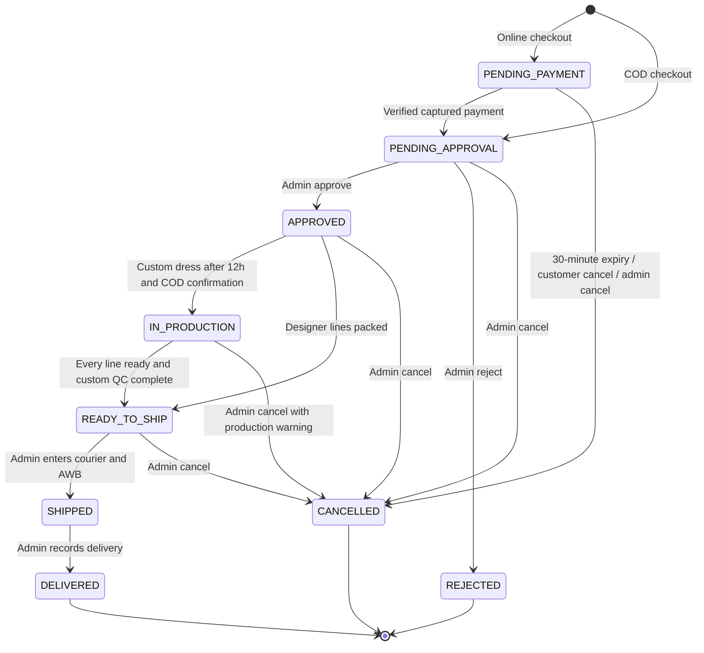

# Order State Machine

Fulfillment and payment are separate state dimensions. Refund status never moves fulfillment backward.

Payment status progresses independently: online `UNPAID`/`FAILED` → verified `PAID`; rejected/cancelled captured orders → `REFUND_REQUIRED` → provider-verified `REFUNDED`. COD progresses `COD_PENDING` → explicit admin `COD_COLLECTED` after delivery. A late capture after cancellation leaves fulfillment `CANCELLED` and sets payment `REFUND_REQUIRED` without re-reserving stock.